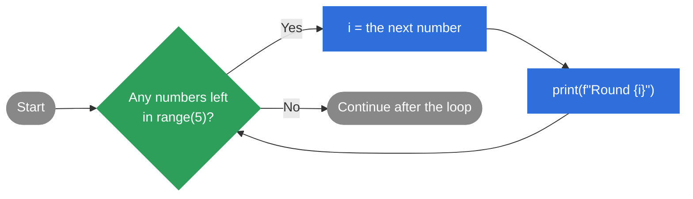
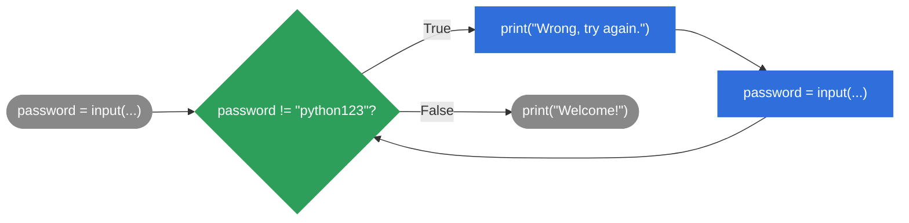
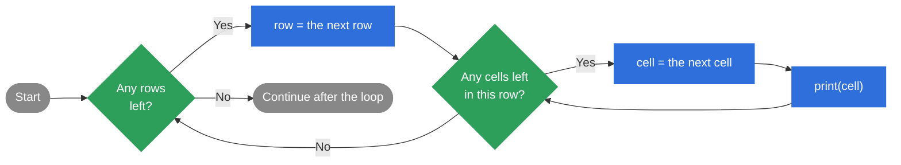

<div class="absolute inset-0 bg-[#E8522A]" />

<!-- Top bar -->
<div class="absolute top-6 left-8 flex items-center gap-3 text-white">
  <div class="w-10 h-10 bg-white rounded flex items-center justify-center">
    <svg viewBox="0 0 40 40" class="w-8 h-8" fill="#E8522A" xmlns="http://www.w3.org/2000/svg">
      <rect x="4" y="4" width="14" height="14" rx="1"/>
      <rect x="22" y="4" width="14" height="14" rx="1"/>
      <rect x="4" y="22" width="14" height="14" rx="1"/>
      <rect x="22" y="22" width="14" height="14" rx="1"/>
    </svg>
  </div>
  <span class="text-lg font-semibold tracking-wide">ReDISchool</span>
</div>
<div class="absolute top-8 right-8 text-white text-lg font-medium">Week 5</div>

<!-- Main content -->
<div class="absolute bottom-32 left-12 right-12 text-white">
  <p class="text-xl font-light opacity-90 mb-2">Introduction to Programming - Fall 2026</p>
  <h1 class="text-6xl font-light leading-tight mb-6">Loops 🔁</h1>
  <p class="text-2xl font-light opacity-90 mt-4">
    A <s class="opacity-70">picture</s> <span class="bg-white text-[#E8522A] font-semibold rounded px-2">loop</span>
    is worth a thousand <s class="opacity-70">words</s> <span class="bg-white text-[#E8522A] font-semibold rounded px-2">lines</span>.
  </p>
</div>

---

<div class="text-sm font-semibold text-[#E8522A] uppercase tracking-widest mb-4">Week 5 — Loops</div>

## Agenda

<div class="agenda">

|  |  |
|---|---|
| 01 | Recap & AMA |
| 02 | Why we need loops |
| 03 | `for` loops with `range()` |
| 04 | `while` loops |
| 05 | `break` and `continue` |
| — | Break (15 min) |
| 06 | Common loop patterns — lists, strings & nested loops |
| 07 | Homework |

</div>

Parts 03, 04, 05 and 06 have short exercises. ✍️

<style>
.agenda td { padding-top: 0.25rem; padding-bottom: 0.25rem; }
</style>

---

<div class="text-sm font-semibold text-[#E8522A] uppercase tracking-widest mb-4">Week 5 — Loops</div>

## 01 - Recap from last week
<br>

Last week we covered:

- ✂️ **Strings** — `+`, `*`, `len()`, and methods like `.lower()` and `.strip()`
- 🧩 **f-strings** — `f"Hello, {name}!"` to build clean output
- ⚖️ **Comparisons** — `==`, `!=`, `<`, `>`, `<=`, `>=`, and `in`
- 🔗 **Logical operators** — `and`, `or`, `not`
- 🔀 **Decisions** — `if` / `elif` / `else`, nesting, and truthy & falsy values

Today we teach our programs to **repeat** things.

---

<div class="text-sm font-semibold text-[#E8522A] uppercase tracking-widest mb-4">Week 5 — Loops</div>

## Quick Reminder: Strings
<br>

<div class="grid grid-cols-2 gap-8 items-start">
<div>

- `+` joins strings, `*` repeats them
- `len()` counts characters, including spaces
- **Methods** are actions you call with a dot `.`
- Methods return a **new** string. Store it to keep it.
- f-strings put values inside text with `{ }`
- `in` checks if a string **contains** some text

</div>
<div>

```python
name = "  alice  "
clean = name.strip().capitalize()

print(clean)              # Alice
print(clean.upper())      # ALICE
print(len(clean))         # 5
print("ha" * 3)           # hahaha
print(f"Hi, {clean}!")    # Hi, Alice!
print("lic" in clean)     # True
print("bob" in clean)     # False

answer = input("yes or no? ").strip().lower()
```

</div>
</div>

---

<div class="text-sm font-semibold text-[#E8522A] uppercase tracking-widest mb-4">Week 5 — Loops</div>

## Quick Reminder: `if` / `elif` / `else`
<br>

<div class="grid grid-cols-2 gap-8 items-start">
<div>

Python checks each condition **from top to bottom**.

- Only the **first** true condition runs.
- `else` catches everything else.
- Two outcomes? `if` / `else` is enough.
- More than two? Add `elif`.
- Join checks with `and`, `or`, `not`.

</div>
<div>

```python
temperature = int(input("Temperature? "))
weather = input("Weather? ").strip().lower()

if weather == "rain" or weather == "snow":
    print("Take an umbrella.")
elif temperature > 25 and weather == "sunny":
    print("Wear a T-shirt.")
elif temperature > 15:
    print("Bring a jacket.")
else:
    print("Wear a coat.")
```

</div>
</div>

---

<div class="text-sm font-semibold text-[#E8522A] uppercase tracking-widest mb-4">Week 5 — Loops</div>

<br>
<br>
<br>
<br>
<br>
<div class="font-bold text-center" style="font-size: 40px;">Questions?</div>

---

<div class="text-sm font-semibold text-[#E8522A] uppercase tracking-widest mb-4">Week 5 — Loops</div>

## 02 - What Is a Loop?
<br>

<div class="grid grid-cols-2 gap-8 items-start">
<div>

A **loop** is a block of code that runs **again and again**: a fixed number of times, or until something tells it to stop.

**Why do we need loops?**

- Print 100 lines without writing 100 prints
- Go through every item in a list
- Keep asking until the user types `"quit"`
- Read every line of a file

</div>
<div>

```python
# Without a loop:
print("Hello!")
print("Hello!")
print("Hello!")
print("Hello!")
print("Hello!")

# With a loop:
for i in range(5):
    print("Hello!")
```

</div>
</div>

---

<div class="text-sm font-semibold text-[#E8522A] uppercase tracking-widest mb-4">Week 5 — Loops</div>

## 03 - Anatomy of a `for` Loop
<br>

<div class="anatomy">
<pre><span class="kw">for</span> <span class="var">i</span> <span class="kw">in</span> <span class="seq">range(5)</span><span class="colon">:</span>
    print(f"Round {<span class="var">i</span>}")</pre>
</div>

<div class="anatomy-notes">

- <span class="kw">for</span> … <span class="kw">in</span> — keywords that shape the loop
- <span class="var">i</span> — the **loop variable**. You pick the name. Each iteration, it holds the next number, and the body can use it
- <span class="seq">range(5)</span> — the sequence we loop over: the numbers `0, 1, 2, 3, 4`
- <span class="colon">:</span> + indent — the end of the first line. The indented code is the **body**, which runs once per item

</div>

<style>
.anatomy pre { font-family: 'Fira Mono', monospace; font-size: 28px; line-height: 1.5; background: var(--slidev-code-background); color: var(--slidev-code-foreground); border-radius: 8px; padding: 0.75rem 1.5rem; margin-bottom: 1.25rem; }
.anatomy-notes li { line-height: 1.8; }
.kw { color: #2f6fdc; font-weight: 700; font-family: 'Fira Mono', monospace; }
.var { color: #E8522A; font-weight: 700; font-family: 'Fira Mono', monospace; }
.seq { color: #2e9e5b; font-weight: 700; font-family: 'Fira Mono', monospace; }
.colon { color: #888888; font-weight: 700; font-family: 'Fira Mono', monospace; }
</style>

---

<div class="text-sm font-semibold text-[#E8522A] uppercase tracking-widest mb-4">Week 5 — Loops</div>

## Step by Step: What `i` Holds
<br>

<div class="grid grid-cols-2 gap-8 items-start">
<div>

```python
for i in range(5):
    print(f"Round {i}")
```

Each time the body runs is called an **iteration**. Python gives `i` a new value before every iteration.

After the last number, there's nothing left, so the loop ends.

</div>
<div>

<table class="trace-table">
  <thead>
    <tr><th scope="col">Iteration</th><th scope="col"><code>i</code> is</th><th scope="col">It prints</th></tr>
  </thead>
  <tbody>
    <tr><td>1st</td><td class="trace-var">0</td><td><code>Round 0</code></td></tr>
    <tr><td>2nd</td><td class="trace-var">1</td><td><code>Round 1</code></td></tr>
    <tr><td>3rd</td><td class="trace-var">2</td><td><code>Round 2</code></td></tr>
    <tr><td>4th</td><td class="trace-var">3</td><td><code>Round 3</code></td></tr>
    <tr><td>5th</td><td class="trace-var">4</td><td><code>Round 4</code></td></tr>
  </tbody>
</table>

</div>
</div>

<style>
.trace-table { width: 100%; border-collapse: collapse; font-size: 1rem; }
.trace-table th,
.trace-table td { border: 1px solid rgba(128, 128, 128, 0.6); padding: 0.3rem 0.75rem; text-align: center; }
.trace-table thead th { background: #2f6fdc; color: #fff; font-weight: 700; }
.trace-table thead th code { background: transparent; color: #fff; }
.trace-table .trace-var { background: #E8522A; color: #fff; font-weight: 700; font-family: 'Fira Mono', monospace; }
</style>

---

<div class="text-sm font-semibold text-[#E8522A] uppercase tracking-widest mb-4">Week 5 — Loops</div>

## How a `for` Loop Runs

<div class="flex justify-center mt-2">



</div>

---

<div class="text-sm font-semibold text-[#E8522A] uppercase tracking-widest mb-4">Week 5 — Loops</div>

## In Plain English
<br>
<br>
<br>

<div class="plain-english">
<p><span class="kw">for</span> each <span class="var">element</span> <span class="kw">in</span> this <span class="seq">range / collection</span><span class="colon">:</span></p>
<p class="pl-16">do something</p>
</div>

<style>
.plain-english p { font-size: 36px; line-height: 1.6; margin: 0; }
.kw { color: #2f6fdc; font-weight: 700; }
.var { color: #E8522A; font-weight: 700; }
.seq { color: #2e9e5b; font-weight: 700; }
.colon { color: #888888; font-weight: 700; }
</style>

---

<div class="text-sm font-semibold text-[#E8522A] uppercase tracking-widest mb-4">Week 5 — Loops</div>

## Inside or After the Loop?

<div class="grid grid-cols-2 gap-6 mt-4 items-start inside-after">
<div class="border-2 border-l-6 border-[#2f6fdc] rounded-lg px-5 py-3">

**Indented** — inside the loop, repeats

```python
for i in range(3):
    print(f"Round {i}")
    print("Done!")
```

```text
Round 0
Done!
Round 1
Done!
Round 2
Done!
```

</div>
<div class="border-2 border-l-6 border-[#2e9e5b] rounded-lg px-5 py-3">

**Not indented** — after the loop, runs once

```python
for i in range(3):
    print(f"Round {i}")
print("Done!")
```

```text
Round 0
Round 1
Round 2
Done!
```

</div>
</div>

<br>

Only the **indented** lines belong to the loop. The first line that isn't indented runs once, after the loop ends.

<style>
.inside-after pre { font-size: 12px !important; line-height: 1.35 !important; }
.inside-after p { margin: 0.25rem 0 0.5rem; }
</style>

---

<div class="text-sm font-semibold text-[#E8522A] uppercase tracking-widest mb-4">Week 5 — Loops</div>

## Exercise 1 — Lap Counter · 5 min

<div class="grid grid-cols-[3fr_2fr] gap-6 mt-4 items-start">
<div>
<div class="border-2 border-l-6 border-[#2e9e5b] rounded-lg px-5 py-3">

✍️ A runner does 4 laps:

1. Use a `for` loop to print one line per lap
2. After the loop, print `Race finished!` once

**Need a hint?**

- `{i + 1}` makes laps start at 1

</div>

Syntax reminder:

```python
for i in range(count):
    # runs every pass
# runs once, after the loop
```

</div>
<div>

Expected output:

```text
Lap 1 done
Lap 2 done
Lap 3 done
Lap 4 done
Race finished!
```

</div>
</div>

---

<div class="text-sm font-semibold text-[#E8522A] uppercase tracking-widest mb-4">Week 5 — Loops</div>

## Exercise 1 — Advanced

<div class="grid grid-cols-[3fr_2fr] gap-6 mt-4 items-start">
<div>
<div class="border-2 border-l-6 border-[#2f6fdc] rounded-lg px-5 py-3">

🔵 Finished early? Now the runner does `laps = 5` laps:

1. Print one line per lap, and mark the **last** lap — when `i + 1` equals `laps`
2. After the loop, print `Race finished!` once

</div>

Syntax reminder:

```python
if condition:
    # the special case
else:
    # every other pass
```

</div>
<div>

Expected output:

```text
Lap 1 done
Lap 2 done
Lap 3 done
Lap 4 done
Lap 5 done - last lap!
Race finished!
```

</div>
</div>

<!-- solution:start -->
---
class: knowledge-solution-slide
---

<div class="text-sm font-semibold text-[#E8522A] uppercase tracking-widest mb-4">Week 5 — Loops</div>

## Exercise 1 — Solution
<br>

```python
for i in range(4):
    print(f"Lap {i + 1} done")
print("Race finished!")
```

<br>

- `i` is `0, 1, 2, 3`, so `i + 1` is `1, 2, 3, 4`.
- `Race finished!` isn't indented, so it runs **once**, after the loop.
<!-- solution:end -->

<!-- solution:start -->
---
class: knowledge-solution-slide
---

<div class="text-sm font-semibold text-[#E8522A] uppercase tracking-widest mb-4">Week 5 — Loops</div>

## Exercise 1 — Advanced Solution
<br>

```python
laps = 5
for i in range(laps):
    if i + 1 == laps:
        print(f"Lap {i + 1} done - last lap!")
    else:
        print(f"Lap {i + 1} done")
print("Race finished!")
```

<br>

- An `if` inside the loop is checked on **every** pass.
- Change `laps` to `8` and both the loop and the last-lap check still work.
<!-- solution:end -->

---

<div class="text-sm font-semibold text-[#E8522A] uppercase tracking-widest mb-4">Week 5 — Loops</div>

## `range()`: Start, Stop, Step
<br>

<div class="grid grid-cols-2 gap-x-8 gap-y-2 range-ways">
<div>

**One argument:** stop

```python
for i in range(5):
    print(i)
```

Prints `0, 1, 2, 3, 4`

</div>
<div>

**Two arguments:** start, stop

```python
for i in range(1, 6):
    print(i)
```

Prints `1, 2, 3, 4, 5`

</div>
<div>

**Three arguments:** start, stop, step

```python
for i in range(0, 10, 2):
    print(i)
```

Prints `0, 2, 4, 6, 8`

</div>
<div>

**Negative step:** count down 🚀

```python
for i in range(5, 0, -1):
    print(i)
```

Prints `5, 4, 3, 2, 1`

</div>
</div>

`range` always stops **before** the stop number. That's why `range(5)` ends at `4`, and `range(5, 0, -1)` ends at `1`.

<style>
.range-ways p { margin: 0.25rem 0; }
.range-ways pre { font-size: 12px !important; line-height: 1.35 !important; }
</style>

---

<div class="text-sm font-semibold text-[#E8522A] uppercase tracking-widest mb-4">Week 5 — Loops</div>

## Exercise 2 — Even Numbers with `for` · 5 min

<div class="grid grid-cols-[3fr_2fr] gap-6 mt-4 items-start">
<div>
<div class="border-2 border-l-6 border-[#2e9e5b] rounded-lg px-5 py-3">

✍️ Print every **even** number from **0 to 20**, including 20, one per line.

Use a `for` loop.

</div>

Syntax reminder:

```python
for number in range(start, stop, step):
    print(number)
# stop itself is never included
```

</div>
<div class="short-output">

Expected output:

```text
0
2
4
6
8
10
12
14
16
18
20
```

</div>
</div>

<style>
.short-output pre { font-size: 11px !important; line-height: 1.3 !important; }
</style>

---

<div class="text-sm font-semibold text-[#E8522A] uppercase tracking-widest mb-4">Week 5 — Loops</div>

## Exercise 2 — Advanced

<div class="grid grid-cols-[3fr_2fr] gap-6 mt-4 items-start">
<div>
<div class="border-2 border-l-6 border-[#2f6fdc] rounded-lg px-5 py-3">

🔵 Finished early? A leap year comes every 4 years.

1. Print every leap year from **2000 to 2040**, including 2040
2. After the loop, print the **next** leap year

</div>

Syntax reminder:

```python
for year in range(start, stop, step):
    print(f"{year} is a leap year")
# year keeps its last value here
```

</div>
<div class="short-output">

Expected output:

```text
2000 is a leap year
2004 is a leap year
2008 is a leap year
2012 is a leap year
2016 is a leap year
2020 is a leap year
2024 is a leap year
2028 is a leap year
2032 is a leap year
2036 is a leap year
2040 is a leap year
Next leap year: 2044
```

</div>
</div>

<style>
.short-output pre { font-size: 11px !important; line-height: 1.3 !important; }
</style>

<!-- solution:start -->
---
class: knowledge-solution-slide
---

<div class="text-sm font-semibold text-[#E8522A] uppercase tracking-widest mb-4">Week 5 — Loops</div>

## Exercise 2 — Solution
<br>

```python
for number in range(0, 21, 2):
    print(number)
```

<br>

- Start at `0` and jump by `2`.
- The stop is `21`, not `20`: `range` stops **before** the stop number, so `20` is still included.
<!-- solution:end -->

<!-- solution:start -->
---
class: knowledge-solution-slide
---

<div class="text-sm font-semibold text-[#E8522A] uppercase tracking-widest mb-4">Week 5 — Loops</div>

## Exercise 2 — Advanced Solution
<br>

```python
for year in range(2000, 2041, 4):
    print(f"{year} is a leap year")
print(f"Next leap year: {year + 4}")
```

<br>

- Start at `2000`, stop **before** `2041`, jump by `4`.
- After the loop, `year` is still `2040`, so `year + 4` is `2044`.
<!-- solution:end -->

---

<div class="text-sm font-semibold text-[#E8522A] uppercase tracking-widest mb-4">Week 5 — Loops</div>

## 04 - Anatomy of a `while` Loop
<br>

<div class="anatomy">
<pre>password = input("Password: ")
<span class="kw">while</span> <span class="cond">password != "python123"</span><span class="colon">:</span>
    print("Wrong, try again.")
    password = input("Password: ")
print("Welcome!")</pre>
</div>

<div class="anatomy-notes">

- <span class="kw">while</span> — the keyword that starts the loop
- <span class="cond">password != "python123"</span> — the **condition**. Python checks it again before every iteration
- <span class="colon">:</span> + indent — the end of the first line. The indented code is the **body**
- We can't know how many tries it takes. That's when `while` makes sense
- ⚠️ The body **must change** what the condition looks at. Otherwise the loop runs forever

</div>

<style>
.anatomy pre { font-family: 'Fira Mono', monospace; font-size: 24px; line-height: 1.45; background: var(--slidev-code-background); color: var(--slidev-code-foreground); border-radius: 8px; padding: 0.75rem 1.5rem; margin-bottom: 1rem; }
.anatomy-notes li { line-height: 1.7; }
.kw { color: #2f6fdc; font-weight: 700; font-family: 'Fira Mono', monospace; }
.cond { color: #2e9e5b; font-weight: 700; font-family: 'Fira Mono', monospace; }
.colon { color: #888888; font-weight: 700; font-family: 'Fira Mono', monospace; }
</style>

---

<div class="text-sm font-semibold text-[#E8522A] uppercase tracking-widest mb-4">Week 5 — Loops</div>

## How a `while` Loop Runs

<div class="flex justify-center mt-2">



</div>

---

<div class="text-sm font-semibold text-[#E8522A] uppercase tracking-widest mb-4">Week 5 — Loops</div>

## In Plain English
<br>
<br>
<br>

<div class="plain-english">
<p><span class="kw">while</span> <span class="cond">this condition is true</span><span class="colon">:</span></p>
<p class="pl-16">keep doing something</p>
</div>

<style>
.plain-english p { font-size: 36px; line-height: 1.6; margin: 0; }
.kw { color: #2f6fdc; font-weight: 700; }
.cond { color: #2e9e5b; font-weight: 700; }
.colon { color: #888888; font-weight: 700; }
</style>

---

<div class="text-sm font-semibold text-[#E8522A] uppercase tracking-widest mb-4">Week 5 — Loops</div>

## Exercise 3 — Savings Goal · 10 min

<div class="grid grid-cols-[3fr_2fr] gap-6 mt-4 items-start">
<div>
<div class="border-2 border-l-6 border-[#2e9e5b] rounded-lg px-5 py-3">

✍️ You start with **0** euros and save **15** euros every week.

Use a `while` loop to keep saving until you have **at least 100** euros.

- Each week, print the week number and your savings.
- At the end, print how many weeks it took.

</div>

Syntax reminder:

```python
while condition:
    # runs again and again while condition is True
    # change something, so it ends!
```

</div>
<div>

Expected output:

```text
Week 1: 15 euros
Week 2: 30 euros
Week 3: 45 euros
Week 4: 60 euros
Week 5: 75 euros
Week 6: 90 euros
Week 7: 105 euros
Goal reached in 7 weeks!
```

</div>
</div>

---

<div class="text-sm font-semibold text-[#E8522A] uppercase tracking-widest mb-4">Week 5 — Loops</div>

## Exercise 3 — Advanced

<div class="grid grid-cols-[3fr_2fr] gap-6 mt-4 items-start">
<div>
<div class="border-2 border-l-6 border-[#2f6fdc] rounded-lg px-5 py-3">

🔵 Finished early? Save **10** euros in week 1, then **5 more** each week (10, 15, 20, …) until you have **at least 100** euros.

Print each week's amount and total, then how many weeks it took.

</div>

Syntax reminder:

```python
while condition:
    total = total + amount
    amount = amount + 5
```

</div>
<div>

Expected output:

```text
Week 1: saved 10, total 10 euros
Week 2: saved 15, total 25 euros
Week 3: saved 20, total 45 euros
Week 4: saved 25, total 70 euros
Week 5: saved 30, total 100 euros
Goal reached in 5 weeks!
```

</div>
</div>

<!-- solution:start -->
---
class: knowledge-solution-slide
---

<div class="text-sm font-semibold text-[#E8522A] uppercase tracking-widest mb-4">Week 5 — Loops</div>

## Exercise 3 — Solution
<br>

```python
savings = 0
weeks = 0
while savings < 100:
    savings = savings + 15
    weeks = weeks + 1
    print(f"Week {weeks}: {savings} euros")
print(f"Goal reached in {weeks} weeks!")
```

- We repeat **until a goal is reached**, not a fixed number of times.
- `savings` grows every iteration, so the condition becomes `False` after week 7.
<!-- solution:end -->

<!-- solution:start -->
---
class: knowledge-solution-slide
---

<div class="text-sm font-semibold text-[#E8522A] uppercase tracking-widest mb-4">Week 5 — Loops</div>

## Exercise 3 — Advanced Solution
<br>

```python
savings = 0
weeks = 0
amount = 10
while savings < 100:
    savings = savings + amount
    weeks = weeks + 1
    print(f"Week {weeks}: saved {amount}, total {savings} euros")
    amount = amount + 5
print(f"Goal reached in {weeks} weeks!")
```

- `amount` grows **after** we print, so next week saves 5 more.
- Both `savings` and `amount` change each pass, so the goal comes sooner.
<!-- solution:end -->

---

<div class="text-sm font-semibold text-[#E8522A] uppercase tracking-widest mb-4">Week 5 — Loops</div>

## `for` or `while`?
<br>

Pick the one that matches **how** you want to repeat.

<div class="grid grid-cols-2 gap-6 mt-4">
<div class="border-2 border-l-6 border-[#2f6fdc] rounded-lg px-5 py-3">

**`for`** — when you know what you're looping over

- a list of items
- a string, letter by letter
- a range of numbers, like `range(5)`
- any collection with a known end

</div>
<div class="border-2 border-l-6 border-[#E8522A] rounded-lg px-5 py-3">

**`while`** — when you keep going until something changes

- until the user types `"quit"`
- while a condition is still `True`
- as long as there's input to read
- until a goal is reached

</div>
</div>

<br>

`for` is for repeating **a known number of times**. `while` is for repeating **until a condition changes**.

---

<div class="text-sm font-semibold text-[#E8522A] uppercase tracking-widest mb-4">Week 5 — Loops</div>

## 05 - `break` and `continue`
<br>

Two keywords that change the flow of a loop.

<div class="grid grid-cols-2 gap-6 mt-4">
<div class="border-2 border-l-6 border-[#E8522A] rounded-lg px-5 py-3">

**`break`** — exits the loop immediately

Python stops looping the moment it reaches `break`, even if items are left.

**Use it when:**

- we found what we were looking for
- something went wrong, so we stop
- the user typed `"quit"`

</div>
<div class="border-2 border-l-6 border-[#2f6fdc] rounded-lg px-5 py-3">

**`continue`** — skips the rest of this iteration

This iteration ends right there, and Python jumps straight to the next item.

**Use it when:**

- data is invalid or empty, so we ignore it
- an item doesn't match what we need
- there's a special case we don't care about

</div>
</div>

---

<div class="text-sm font-semibold text-[#E8522A] uppercase tracking-widest mb-4">Week 5 — Loops</div>

## `break` vs. `continue` in Code
<br>

<div class="grid grid-cols-2 gap-8 items-start">
<div>

**`break`** — stop the loop entirely

```python
for i in range(10):
    if i == 5:
        break
    print(i)
```

Output: `0, 1, 2, 3, 4`

The loop quits the moment `i` reaches `5`.

</div>
<div>

**`continue`** — skip this iteration, keep going

```python
for i in range(10):
    if i == 5:
        continue
    print(i)
```

Output: `0, 1, 2, 3, 4, 6, 7, 8, 9`

The loop skips `5`, but carries on through `9`.

</div>
</div>

<br>

`break` **leaves** the loop. `continue` **jumps** to the next iteration.

---

<div class="text-sm font-semibold text-[#E8522A] uppercase tracking-widest mb-4">Week 5 — Loops</div>

## Exercise 4 — Squares Between 10 and 50 · 10 min

<div class="grid grid-cols-[3fr_2fr] gap-6 mt-4 items-start">
<div>
<div class="border-2 border-l-6 border-[#2e9e5b] rounded-lg px-5 py-3">

✍️ Print the squares of 1, 2, 3, … one per line.

1. Use `for` with `range(1, 100)`
2. Use `continue` to **skip** squares smaller than 10
3. Use `break` to **stop** when a square is bigger than 50

</div>

Syntax reminder:

```python
for i in range(start, stop):
    if condition:
        continue  # skip to the next i
    if condition:
        break     # leave the loop
```

</div>
<div>

Expected output:

```text
4 * 4 = 16
5 * 5 = 25
6 * 6 = 36
7 * 7 = 49
```

</div>
</div>

---

<div class="text-sm font-semibold text-[#E8522A] uppercase tracking-widest mb-4">Week 5 — Loops</div>

## Exercise 4 — Advanced

<div class="grid grid-cols-[3fr_2fr] gap-6 mt-4 items-start">
<div>
<div class="border-2 border-l-6 border-[#2f6fdc] rounded-lg px-5 py-3">

🔵 Finished early? Do the same with **cubes** (`n * n * n`):

1. Use `for` with `range(1, 100)`
2. Skip cubes smaller than **10**
3. When a cube is bigger than **500**, print `Stopped at` and the number, then stop

</div>

Syntax reminder:

```python
if condition:
    print("...")  # runs first
    break         # then leaves the loop
```

</div>
<div>

Expected output:

```text
3 * 3 * 3 = 27
4 * 4 * 4 = 64
5 * 5 * 5 = 125
6 * 6 * 6 = 216
7 * 7 * 7 = 343
Stopped at 8
```

</div>
</div>

<!-- solution:start -->
---
class: knowledge-solution-slide
---

<div class="text-sm font-semibold text-[#E8522A] uppercase tracking-widest mb-4">Week 5 — Loops</div>

## Exercise 4 — Solution
<br>

```python
for n in range(1, 100):
    square = n * n
    if square < 10:
        continue
    if square > 50:
        break
    print(f"{n} * {n} = {square}")
```

<br>

- `continue` skips 1, 4 and 9, but the loop keeps going.
- `break` ends the loop at 64, so nothing after it is checked.
<!-- solution:end -->

<!-- solution:start -->
---
class: knowledge-solution-slide
---

<div class="text-sm font-semibold text-[#E8522A] uppercase tracking-widest mb-4">Week 5 — Loops</div>

## Exercise 4 — Advanced Solution
<br>

```python
for n in range(1, 100):
    cube = n * n * n
    if cube < 10:
        continue
    if cube > 500:
        print(f"Stopped at {n}")
        break
    print(f"{n} * {n} * {n} = {cube}")
```

<br>

- The `print` before `break` runs once, then the loop ends.
- `8 * 8 * 8` is `512`, the first cube bigger than 500.
<!-- solution:end -->

---

<div class="absolute inset-0 bg-[#E8522A]" />

<div class="absolute top-8 right-8 text-white text-lg font-medium">Week 5</div>

<div class="absolute bottom-32 left-12 right-12 text-white">
  <h1 class="text-6xl font-light leading-tight mb-6" style="font-size: 60px;">Break (15 min) ☕</h1>
</div>

---

<div class="absolute inset-0 bg-[#E8522A]" />

<div class="absolute top-8 right-8 text-white text-lg font-medium">Week 5</div>

<div class="absolute bottom-32 left-12 right-12 text-white">
  <h1 class="text-6xl font-light leading-tight mb-6" style="font-size: 60px;">06 - Common loop patterns 💡</h1>
  <p class="text-2xl font-light opacity-90 mt-4">Lists, strings and nested loops</p>
</div>

---

<div class="text-sm font-semibold text-[#E8522A] uppercase tracking-widest mb-4">Week 5 — Loops</div>

## Sneak Peek: What Is a List?
<br>

<div class="grid grid-cols-2 gap-8 items-start">
<div>

A **list** holds many values in order, inside square brackets `[ ]`, separated by commas.

- One variable instead of `name1`, `name2`, `name3`
- The values are called **items**
- `len()` tells you how many items there are
- We'll learn much more about lists later

</div>
<div>

```python
names = ["Anna", "Bruno", "Carla"]

print(names)
# ['Anna', 'Bruno', 'Carla']
print(len(names))   # 3
```

</div>
</div>

---

<div class="text-sm font-semibold text-[#E8522A] uppercase tracking-widest mb-4">Week 5 — Loops</div>

## Looping Over a List
<br>

<div class="grid grid-cols-2 gap-8 items-start">
<div>

You can loop over a list with `for`, just like over a `range()`.

- No `range()` needed, just the list itself
- The loop variable takes each item in turn
- The loop runs once per item, so you never need to count

</div>
<div>

```python
names = ["Anna", "Bruno", "Carla"]

for name in names:
    print("Hello,", name)
```

```text
Hello, Anna
Hello, Bruno
Hello, Carla
```

</div>
</div>

<br>

It's the same `for ... in ...` pattern as before.

---

<div class="text-sm font-semibold text-[#E8522A] uppercase tracking-widest mb-4">Week 5 — Loops</div>

## Looping Over a String
<br>

A string is a sequence of letters, so you can loop through it the same way.

<div class="grid grid-cols-2 gap-8 items-start short-output">
<div>

The code:

```python
for letter in "Python":
    print(letter)
```

</div>
<div>

The output:

```text
P
y
t
h
o
n
```

</div>
</div>

<br>

Same `for ... in ...` pattern. Python treats the string as a sequence of its characters.

<style>
.short-output pre { font-size: 12px !important; line-height: 1.3 !important; }
</style>

---

<div class="text-sm font-semibold text-[#E8522A] uppercase tracking-widest mb-4">Week 5 — Loops</div>

## Pattern 1 — Filtering
<br>

<div class="grid grid-cols-2 gap-8 items-start">
<div>

**Filtering** means keeping only the items that match a condition.

- Loop over every item
- Use `if` to check the condition
- Print only the items that pass

</div>
<div>

```python
scores = [12, 45, 7, 30, 18]

for score in scores:
    if score > 15:
        print(score)
```

```text
45
30
18
```

</div>
</div>

---

<div class="text-sm font-semibold text-[#E8522A] uppercase tracking-widest mb-4">Week 5 — Loops</div>

## Exercise 5 — Skip the Zeros · 10 min

<div class="grid grid-cols-[3fr_2fr] gap-6 mt-4 items-start">
<div>
<div class="border-2 border-l-6 border-[#2e9e5b] rounded-lg px-5 py-3">

✍️ Print each score from the list, but **skip** any zeros.

```python
scores = [10, 0, 25, 0, 8, 0, 3]
```

</div>

Syntax reminder:

```python
for item in my_list:
    if condition:
        print(item)
# != means "is not equal to"
```

</div>
<div>

Expected output:

```text
10
25
8
3
```

</div>
</div>

---

<div class="text-sm font-semibold text-[#E8522A] uppercase tracking-widest mb-4">Week 5 — Loops</div>

## Exercise 5 — Advanced

<div class="grid grid-cols-[3fr_2fr] gap-6 mt-4 items-start">
<div>
<div class="border-2 border-l-6 border-[#2f6fdc] rounded-lg px-5 py-3">

🔵 Finished early? Clean up a messy shopping list:

```python
items = [" milk", "", "bread ", "   ", "eggs"]
```

- **Skip** items that are empty or only spaces
- Print the others without spaces, starting with a capital letter

</div>

Syntax reminder:

```python
text.strip()       # removes spaces at both ends
text.capitalize()  # first letter upper case
# an empty string "" counts as False
```

</div>
<div>

Expected output:

```text
Milk
Bread
Eggs
```

</div>
</div>

<!-- solution:start -->
---
class: knowledge-solution-slide
---

<div class="text-sm font-semibold text-[#E8522A] uppercase tracking-widest mb-4">Week 5 — Loops</div>

## Exercise 5 — Solution
<br>

```python
scores = [10, 0, 25, 0, 8, 0, 3]

for score in scores:
    if score != 0:
        print(score)
```

<br>

- This is the filtering pattern: only scores that are not `0` get printed.
- Using `if score == 0: continue` before `print(score)` gives the same result.
<!-- solution:end -->

<!-- solution:start -->
---
class: knowledge-solution-slide
---

<div class="text-sm font-semibold text-[#E8522A] uppercase tracking-widest mb-4">Week 5 — Loops</div>

## Exercise 5 — Advanced Solution
<br>

```python
items = [" milk", "", "bread ", "   ", "eggs"]

for item in items:
    clean = item.strip()
    if clean:
        print(clean.capitalize())
```

<br>

- `"   ".strip()` gives `""`, which counts as `False`, so it's skipped.
- Cleaning **first** means one check handles both kinds of blank items.
<!-- solution:end -->

---

<div class="text-sm font-semibold text-[#E8522A] uppercase tracking-widest mb-4">Week 5 — Loops</div>

## Pattern 2 — Find
<br>

<div class="grid grid-cols-2 gap-8 items-start">
<div>

**Find** means saving the first item that matches a condition in a variable.

- **Before** the loop: create the variable
- **Inside**: when an item matches, save it and `break`
- **After**: use the variable

</div>
<div>

```python
scores = [12, 45, 7, 30, 18]

first_big = 0
for score in scores:
    if score > 40:
        first_big = score
        break

print(f"First big score: {first_big}")
```

```text
First big score: 45
```

</div>
</div>

---

<div class="text-sm font-semibold text-[#E8522A] uppercase tracking-widest mb-4">Week 5 — Loops</div>

## Exercise 6 — Wrong Phone Number · 10 min

<div class="grid grid-cols-[3fr_2fr] gap-6 mt-4 items-start">
<div>
<div class="border-2 border-l-6 border-[#2e9e5b] rounded-lg px-5 py-3">

✍️ Valid phone numbers have exactly **11 digits**. Print the **first** wrong one **after** the loop.

```python
phones = ["01761234567", "01523456789",
          "01709876543", "0162345678",
          "01601234567", "015712345678"]
```

</div>

Syntax reminder:

```python
found = ""
for item in my_list:
    if condition:
        found = item
        break
# len(text) gives the number of characters
```

</div>
<div>

Expected output:

```text
First wrong number: 0162345678
```

</div>
</div>

---

<div class="text-sm font-semibold text-[#E8522A] uppercase tracking-widest mb-4">Week 5 — Loops</div>

## Exercise 6 — Advanced

<div class="grid grid-cols-[3fr_2fr] gap-6 mt-4 items-start">
<div>
<div class="border-2 border-l-6 border-[#2f6fdc] rounded-lg px-5 py-3">

🔵 Finished early? Use the same list, but also:

- Print the wrong number's **position** in the list: the first number is 1, the second is 2, …
- If every number is fine, print `All numbers look fine`

</div>

Syntax reminder:

```python
position = 0
for item in my_list:
    position = position + 1
# after the loop: if found == "": ...
```

</div>
<div>

Expected output:

```text
First wrong number: 0162345678 (position 4)
```

</div>
</div>

<!-- solution:start -->
---
class: knowledge-solution-slide
---

<div class="text-sm font-semibold text-[#E8522A] uppercase tracking-widest mb-4">Week 5 — Loops</div>

## Exercise 6 — Solution
<br>

```python
phones = ["01761234567", "01523456789",
          "01709876543", "0162345678",
          "01601234567", "015712345678"]

wrong = ""
for phone in phones:
    if len(phone) != 11:
        wrong = phone
        break

print(f"First wrong number: {wrong}")
```

- `break` stops at the first match. Without it, `wrong` would end up as `"015712345678"`.
<!-- solution:end -->

<!-- solution:start -->
---
class: knowledge-solution-slide
---

<div class="text-sm font-semibold text-[#E8522A] uppercase tracking-widest mb-4">Week 5 — Loops</div>

## Exercise 6 — Advanced Solution

```python
phones = ["01761234567", "01523456789",
          "01709876543", "0162345678",
          "01601234567", "015712345678"]

wrong = ""
position = 0
for phone in phones:
    position = position + 1
    if len(phone) != 11:
        wrong = phone
        break

if wrong == "":
    print("All numbers look fine")
else:
    print(f"First wrong number: {wrong} (position {position})")
```

- `break` also stops `position` from counting further, so it stays at `4`.
<!-- solution:end -->

---

<div class="text-sm font-semibold text-[#E8522A] uppercase tracking-widest mb-4">Week 5 — Loops</div>

## Pattern 3 — Accumulating
<br>

<div class="grid grid-cols-2 gap-8 items-start">
<div>

**Accumulating** means adding up all the items.

- **Before** the loop: start the total at `0`
- **Inside**: add each item to the total
- **After**: use the total

</div>
<div>

```python
scores = [12, 45, 7, 30, 18]

total = 0
for score in scores:
    total = total + score

print(f"Total: {total}")
```

```text
Total: 112
```

</div>
</div>

---

<div class="text-sm font-semibold text-[#E8522A] uppercase tracking-widest mb-4">Week 5 — Loops</div>

## Exercise 7 — Average Score · 10 min

<div class="grid grid-cols-[3fr_2fr] gap-6 mt-4 items-start">
<div>
<div class="border-2 border-l-6 border-[#2e9e5b] rounded-lg px-5 py-3">

✍️ Use a loop to add up the scores. Then divide the total by the number of scores and print the **average**.

```python
scores = [8, 6, 10, 4, 7]
```

</div>

Syntax reminder:

```python
total = 0
for item in my_list:
    total = total + item
# len(my_list) gives the number of items
```

</div>
<div>

Expected output:

```text
Average: 7.0
```

</div>
</div>

---

<div class="text-sm font-semibold text-[#E8522A] uppercase tracking-widest mb-4">Week 5 — Loops</div>

## Exercise 7 — Advanced

<div class="grid grid-cols-[3fr_2fr] gap-6 mt-4 items-start">
<div>
<div class="border-2 border-l-6 border-[#2f6fdc] rounded-lg px-5 py-3">

🔵 Finished early? Only scores of **5 or more** pass. Print how many scores passed and their **average**.

```python
scores = [8, 2, 10, 4, 6]
```

</div>

Syntax reminder:

```python
for item in my_list:
    if condition:
        total = total + item
        count = count + 1  # len() would count all
```

</div>
<div>

Expected output:

```text
Passing scores: 3
Average of passing scores: 8.0
```

</div>
</div>

<!-- solution:start -->
---
class: knowledge-solution-slide
---

<div class="text-sm font-semibold text-[#E8522A] uppercase tracking-widest mb-4">Week 5 — Loops</div>

## Exercise 7 — Solution
<br>

```python
scores = [8, 6, 10, 4, 7]

total = 0
for score in scores:
    total = total + score

average = total / len(scores)
print(f"Average: {average}")
```

<br>

- `len(scores)` is `5`, so the average is `35 / 5`.
- `/` always gives a decimal number, so the result is `7.0`.
<!-- solution:end -->

<!-- solution:start -->
---
class: knowledge-solution-slide
---

<div class="text-sm font-semibold text-[#E8522A] uppercase tracking-widest mb-4">Week 5 — Loops</div>

## Exercise 7 — Advanced Solution
<br>

```python
scores = [8, 2, 10, 4, 6]

total = 0
count = 0
for score in scores:
    if score >= 5:
        total = total + score
        count = count + 1

print(f"Passing scores: {count}")
print(f"Average of passing scores: {total / count}")
```

- This combines **filtering** and **accumulating**: `8 + 10 + 6 = 24`, and `24 / 3 = 8.0`.
<!-- solution:end -->

---

<div class="text-sm font-semibold text-[#E8522A] uppercase tracking-widest mb-4">Week 5 — Loops</div>

## Pattern 4 — Finding the Max
<br>

<div class="grid grid-cols-2 gap-8 items-start">
<div>

**Finding the max** means keeping the biggest item seen so far.

- **Before** the loop: start `highest` at `0`
- **Inside**: if an item is bigger, it becomes the new `highest`
- **After**: `highest` holds the biggest item

</div>
<div>

```python
scores = [12, 45, 7, 30, 18]

highest = 0
for score in scores:
    if score > highest:
        highest = score

print(f"Highest: {highest}")
```

```text
Highest: 45
```

</div>
</div>

<br>

Patterns 2–4 have the same shape: **create** a variable before the loop, **update** it inside, **use** it after.

---

<div class="text-sm font-semibold text-[#E8522A] uppercase tracking-widest mb-4">Week 5 — Loops</div>

## Nested Loops
<br>

A loop inside a loop — each outer pass runs the inner loop **completely**. Here, a list holds other lists, like the rows of a table.

<div class="grid grid-cols-2 gap-8 items-start short-output">
<div>

The code:

```python
table = [[1, 2, 3],
         [4, 5, 6]]

for row in table:
    for cell in row:
        print(cell)
```

</div>
<div>

The output:

```text
1
2
3
4
5
6
```

</div>
</div>

The inner loop runs once for every item of the outer loop — 2 rows × 3 cells = 6 lines.

<style>
.short-output pre { font-size: 12px !important; line-height: 1.3 !important; }
</style>

---

<div class="text-sm font-semibold text-[#E8522A] uppercase tracking-widest mb-4">Week 5 — Loops</div>

## Step by Step: Nested Loops
<br>

<div class="grid grid-cols-[2fr_3fr] gap-8 items-start">
<div>

```python
for row in table:
    for cell in row:
        print(cell)
```

`row` stays the same while the inner loop goes through **every** cell in it.

Then the outer loop moves to the next row, and the inner loop starts again.

</div>
<div>

<table class="trace-table">
  <thead>
    <tr><th scope="col">Iteration</th><th scope="col"><code>row</code> is</th><th scope="col"><code>cell</code> is</th><th scope="col">It prints</th></tr>
  </thead>
  <tbody>
    <tr><td>1st</td><td class="trace-var">[1, 2, 3]</td><td class="trace-inner">1</td><td><code>1</code></td></tr>
    <tr><td>2nd</td><td class="trace-var">[1, 2, 3]</td><td class="trace-inner">2</td><td><code>2</code></td></tr>
    <tr><td>3rd</td><td class="trace-var">[1, 2, 3]</td><td class="trace-inner">3</td><td><code>3</code></td></tr>
    <tr><td>4th</td><td class="trace-var">[4, 5, 6]</td><td class="trace-inner">4</td><td><code>4</code></td></tr>
    <tr><td>5th</td><td class="trace-var">[4, 5, 6]</td><td class="trace-inner">5</td><td><code>5</code></td></tr>
    <tr><td>6th</td><td class="trace-var">[4, 5, 6]</td><td class="trace-inner">6</td><td><code>6</code></td></tr>
  </tbody>
</table>

</div>
</div>

<style>
.trace-table { width: 100%; border-collapse: collapse; font-size: 1rem; }
.trace-table th,
.trace-table td { border: 1px solid rgba(128, 128, 128, 0.6); padding: 0.3rem 0.75rem; text-align: center; }
.trace-table thead th { background: #2f6fdc; color: #fff; font-weight: 700; }
.trace-table thead th code { background: transparent; color: #fff; }
.trace-table .trace-var { background: #E8522A; color: #fff; font-weight: 700; font-family: 'Fira Mono', monospace; }
.trace-table .trace-inner { background: #2e9e5b; color: #fff; font-weight: 700; font-family: 'Fira Mono', monospace; }
.trace-table th,
.trace-table td { white-space: nowrap; padding: 0.3rem 0.5rem; }
</style>

---

<div class="text-sm font-semibold text-[#E8522A] uppercase tracking-widest mb-4">Week 5 — Loops</div>

## How Nested Loops Run

<div class="flex justify-center mt-2">



</div>

When the inner loop runs out of cells, it goes back to the outer loop for the next row.

---

<div class="text-sm font-semibold text-[#E8522A] uppercase tracking-widest mb-4">Week 5 — Loops</div>

## What We Learned Today
<br>

✅ **`for`** repeats a known number of times, **`while`** repeats until a condition changes

✅ **`range()`** counts for you, and always stops **before** the stop number

✅ Indented lines run **every pass**; unindented lines run once, **after** the loop

✅ **`break`** leaves the loop, **`continue`** skips the current iteration

✅ A **list** `[ ]` holds many values. `for` can loop over lists and strings

✅ Common patterns: **filter**, **find**, **accumulate**, and **find the max**

✅ **Nested loops** run a whole inner loop for each outer pass, like rows and cells of a table

Just like with `if` / `elif` / `else`, the right loop depends on the task.
Practice is how you'll learn which one fits each job, and why. Now it's time to practise! 💪

---

<div class="text-sm font-semibold text-[#E8522A] uppercase tracking-widest mb-4">Week 5 — Loops</div>

<br>
<br>
<br>
<br>
<br>
<br>
<div class="font-bold uppercase tracking-widest mb-18 text-center" style="font-size: 40px;">Questions?</div>

---

<div class="absolute inset-0 bg-[#E8522A]" />

<div class="absolute top-8 right-8 text-white text-lg font-medium">Week 5</div>

<div class="absolute bottom-32 left-12 right-12 text-white">
  <h1 class="text-6xl font-light leading-tight mb-6" style="font-size: 60px;">07 - Homework! 🏠</h1>
  <p class="text-2xl font-light opacity-90 mt-4">📌 Commit your work to GitHub when you're done!</p>
</div>

---

<div class="text-sm font-semibold text-[#E8522A] uppercase tracking-widest mb-4">Week 5 — Loops</div>

## Homework 1 — Count to 20

<div class="grid grid-cols-[3fr_2fr] gap-6 mt-4 items-start">
<div class="border-2 border-l-6 border-[#E8522A] rounded-lg px-5 py-3">

🏠 Print the numbers from **1 to 20**, one per line.

</div>
<div>

Expected output:

```text
1
2
3
...
19
20
```

</div>
</div>

---

<div class="text-sm font-semibold text-[#E8522A] uppercase tracking-widest mb-4">Week 5 — Loops</div>

## Homework 2 — Say Hi to Your Friends

<div class="grid grid-cols-[3fr_2fr] gap-6 mt-4 items-start">
<div class="border-2 border-l-6 border-[#E8522A] rounded-lg px-5 py-3">

🏠 For each friend in the list, print `Hi, <name>`:

```python
friends = ["Anna", "Bruno", "Carla"]
```

</div>
<div>

Expected output:

```text
Hi, Anna
Hi, Bruno
Hi, Carla
```

</div>
</div>

---

<div class="text-sm font-semibold text-[#E8522A] uppercase tracking-widest mb-4">Week 5 — Loops</div>

## Homework 3 — Countdown by Twos

<div class="grid grid-cols-[3fr_2fr] gap-6 mt-4 items-start">
<div class="border-2 border-l-6 border-[#E8522A] rounded-lg px-5 py-3">

🏠 Count down from **20 to 2** in steps of **2**, then print `"Done!"`.

</div>
<div class="short-output">

Expected output:

```text
20
18
16
14
12
10
8
6
4
2
Done!
```

</div>
</div>

<style>
.short-output pre { font-size: 11px !important; line-height: 1.3 !important; }
</style>

---

<div class="text-sm font-semibold text-[#E8522A] uppercase tracking-widest mb-4">Week 5 — Loops</div>

## Homework 4 — Add It Up

<div class="grid grid-cols-[3fr_2fr] gap-6 mt-4 items-start">
<div class="border-2 border-l-6 border-[#E8522A] rounded-lg px-5 py-3">

🏠 Add up all the numbers from **1 to 100** and print the total.

</div>
<div>

Expected output:

```text
5050
```

</div>
</div>

---

<div class="text-sm font-semibold text-[#E8522A] uppercase tracking-widest mb-4">Week 5 — Loops</div>

## Homework 5 — Count the Vowels

<div class="grid grid-cols-[3fr_2fr] gap-6 mt-4 items-start">
<div class="border-2 border-l-6 border-[#E8522A] rounded-lg px-5 py-3">

🏠 How many vowels (`a`, `e`, `i`, `o`, `u`) are in the word `"programming"`?

Print the count.

</div>
<div>

Expected output:

```text
3
```

</div>
</div>

---

<div class="text-sm font-semibold text-[#E8522A] uppercase tracking-widest mb-4">Week 5 — Loops</div>

## Homework 6 — Even or Odd?

<div class="grid grid-cols-[3fr_2fr] gap-6 mt-2 items-start">
<div class="border-2 border-l-6 border-[#E8522A] rounded-lg px-5 py-2 even-odd">

🏠 For each number in the list, print whether it's even or odd:

```python
numbers = [3, 8, 15, 22, 7]
```

**New:** `%` (called **modulo**) gives the remainder left over after dividing:

- `10 % 3` → `1` (10 ÷ 3 = 3, with 1 left over)
- `8 % 2` → `0` (8 divides by 2 exactly)
- `7 % 2` → `1` (odd numbers leave 1 over)

So `n % 2 == 0` means `n` divides evenly by 2: it's even.

</div>
<div>

Expected output:

```text
3 is odd
8 is even
15 is odd
22 is even
7 is odd
```

</div>
</div>

<style>
.even-odd p { margin: 0.35rem 0; }
.even-odd ul { margin: 0.25rem 0; }
.even-odd li { margin: 0; line-height: 1.5; }
</style>

---

<div class="text-sm font-semibold text-[#E8522A] uppercase tracking-widest mb-4">Week 5 — Loops</div>

## Homework 7 — Number Grid

<div class="grid grid-cols-[3fr_2fr] gap-6 mt-4 items-start">
<div class="border-2 border-l-6 border-[#E8522A] rounded-lg px-5 py-3">

🏠 Print a 5 × 5 grid where each row shows `1 2 3 4 5`.

**Hint:** by default, every `print()` ends with a new line. That's why each call starts a fresh line. `end="..."` changes that:

- `print(n, end=" ")` → the value and a space, on the same line
- `print()` on its own → just a new line, to end the row

</div>
<div>

Expected output:

```text
1 2 3 4 5
1 2 3 4 5
1 2 3 4 5
1 2 3 4 5
1 2 3 4 5
```

</div>
</div>

---

<div class="text-sm font-semibold text-[#E8522A] uppercase tracking-widest mb-4">Week 5 — Loops</div>

## Homework 8 — Multiplication Table

<div class="grid grid-cols-[3fr_2fr] gap-6 mt-4 items-start">
<div class="border-2 border-l-6 border-[#E8522A] rounded-lg px-5 py-3">

🏠 Print a multiplication table for **1 to 5**.

An empty line after each group makes it easier to read.

</div>
<div class="short-output">

Expected output (first rows):

```text
1 * 1 = 1
1 * 2 = 2
1 * 3 = 3
1 * 4 = 4
1 * 5 = 5

2 * 1 = 2
...
```

</div>
</div>

<style>
.short-output pre { font-size: 12px !important; line-height: 1.35 !important; }
</style>

---

<div class="text-sm font-semibold text-[#E8522A] uppercase tracking-widest mb-4">Week 5 — Loops</div>

## Homework 9 — The Largest Number

<div class="grid grid-cols-[3fr_2fr] gap-6 mt-4 items-start">
<div class="border-2 border-l-6 border-[#E8522A] rounded-lg px-5 py-3">

🏠 Find and print the largest number in the list:

```python
numbers = [4, 19, 2, 8, 11]
```

</div>
<div>

Expected output:

```text
19
```

</div>
</div>

---

<div class="text-sm font-semibold text-[#E8522A] uppercase tracking-widest mb-4">Week 5 — Loops</div>

## Homework 10 — Numbers and Squares

<div class="grid grid-cols-[3fr_2fr] gap-6 mt-4 items-start">
<div class="border-2 border-l-6 border-[#E8522A] rounded-lg px-5 py-3">

🏠 For each number from **1 to 10**, print the number and its square, separated by a space.

</div>
<div class="short-output">

Expected output:

```text
1 1
2 4
3 9
4 16
5 25
6 36
7 49
8 64
9 81
10 100
```

</div>
</div>

<style>
.short-output pre { font-size: 11px !important; line-height: 1.3 !important; }
</style>

---

<div class="text-sm font-semibold text-[#E8522A] uppercase tracking-widest mb-4">Week 5 — Loops</div>

## Homework 11 — FizzBuzz

<div class="grid grid-cols-[3fr_2fr] gap-6 mt-4 items-start">
<div class="border-2 border-l-6 border-[#E8522A] rounded-lg px-5 py-3">

🏠 For each number from **1 to 20**:

- Multiple of 3 → print `Fizz`
- Multiple of 5 → print `Buzz`
- Multiple of both → print `FizzBuzz`
- Otherwise → print the number

</div>
<div class="short-output">

Expected output (first lines):

```text
1
2
Fizz
4
Buzz
Fizz
7
8
Fizz
Buzz
...
```

</div>
</div>

<style>
.short-output pre { font-size: 11px !important; line-height: 1.3 !important; }
</style>

<!-- solution:start -->
---
class: knowledge-solution-slide
---

<div class="text-sm font-semibold text-[#E8522A] uppercase tracking-widest mb-2">Week 5 — Loops</div>

## Homework Solutions — 1 to 4

<div class="grid grid-cols-2 gap-x-6 gap-y-1 homework-solutions">
<div>

**1 · Count to 20**

```python
for number in range(1, 21):
    print(number)
```

</div>
<div>

**2 · Say hi to your friends**

```python
friends = ["Anna", "Bruno", "Carla"]

for friend in friends:
    print(f"Hi, {friend}")
```

</div>
<div>

**3 · Countdown by twos**

```python
for number in range(20, 0, -2):
    print(number)
print("Done!")
```

</div>
<div>

**4 · Add it up**

```python
total = 0
for number in range(1, 101):
    total = total + number
print(total)
```

</div>
</div>

<style>
.homework-solutions p { margin: 0.4rem 0 0.15rem; }
.homework-solutions pre { font-size: 12px !important; line-height: 1.35 !important; }
</style>
<!-- solution:end -->

<!-- solution:start -->
---
class: knowledge-solution-slide
---

<div class="text-sm font-semibold text-[#E8522A] uppercase tracking-widest mb-2">Week 5 — Loops</div>

## Homework Solutions — 5 to 8

<div class="grid grid-cols-2 gap-x-6 gap-y-1 homework-solutions">
<div>

**5 · Count the vowels**

```python
count = 0
for letter in "programming":
    if letter in "aeiou":
        count = count + 1
print(count)
```

</div>
<div>

**6 · Even or odd?**

```python
numbers = [3, 8, 15, 22, 7]

for number in numbers:
    if number % 2 == 0:
        print(f"{number} is even")
    else:
        print(f"{number} is odd")
```

</div>
<div>

**7 · Number grid**

```python
for row in range(5):
    for number in range(1, 6):
        print(number, end=" ")
    print()
```

</div>
<div>

**8 · Multiplication table**

```python
for a in range(1, 6):
    for b in range(1, 6):
        print(f"{a} * {b} = {a * b}")
    print()
```

</div>
</div>

<style>
.homework-solutions p { margin: 0.4rem 0 0.15rem; }
.homework-solutions pre { font-size: 12px !important; line-height: 1.35 !important; }
</style>
<!-- solution:end -->

<!-- solution:start -->
---
class: knowledge-solution-slide
---

<div class="text-sm font-semibold text-[#E8522A] uppercase tracking-widest mb-2">Week 5 — Loops</div>

## Homework Solutions — 9 to 11

<div class="grid grid-cols-2 gap-x-6 gap-y-1 homework-solutions">
<div>

**9 · The largest number**

```python
numbers = [4, 19, 2, 8, 11]

largest = 0
for number in numbers:
    if number > largest:
        largest = number
print(largest)
```

Starting at `0` works here because every number is positive.

**10 · Numbers and squares**

```python
for number in range(1, 11):
    print(number, number * number)
```

</div>
<div>

**11 · FizzBuzz**

```python
for number in range(1, 21):
    if number % 3 == 0 and number % 5 == 0:
        print("FizzBuzz")
    elif number % 3 == 0:
        print("Fizz")
    elif number % 5 == 0:
        print("Buzz")
    else:
        print(number)
```

Check "both" **first**, or `15` would stop at `Fizz`.

</div>
</div>

<style>
.homework-solutions p { margin: 0.4rem 0 0.15rem; }
.homework-solutions pre { font-size: 12px !important; line-height: 1.35 !important; }
</style>
<!-- solution:end -->

---

<div class="absolute inset-0 bg-[#E8522A]" />

<!-- Top bar -->
<div class="absolute top-6 left-8 flex items-center gap-3 text-white">
  <div class="w-10 h-10 bg-white rounded flex items-center justify-center">
    <svg viewBox="0 0 40 40" class="w-8 h-8" fill="#E8522A" xmlns="http://www.w3.org/2000/svg">
      <rect x="4" y="4" width="14" height="14" rx="1"/>
      <rect x="22" y="4" width="14" height="14" rx="1"/>
      <rect x="4" y="22" width="14" height="14" rx="1"/>
      <rect x="22" y="22" width="14" height="14" rx="1"/>
    </svg>
  </div>
  <span class="text-lg font-semibold tracking-wide">ReDISchool</span>
</div>
<div class="absolute top-8 right-8 text-white text-lg font-medium">Week 5</div>

<!-- Main content -->
<div class="absolute bottom-32 left-12 right-12 text-white">
  <h1 class="text-6xl font-light leading-tight mb-6" style="font-size: 60px;">🎉 See you next week!</h1>
</div>
