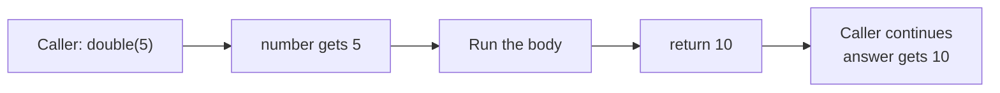

<div class="absolute inset-0 bg-[#E8522A]" />

<div class="absolute top-6 left-8 flex items-center gap-3 text-white">
  <div class="w-10 h-10 bg-white rounded flex items-center justify-center">
    <svg viewBox="0 0 40 40" class="w-8 h-8" fill="#E8522A" xmlns="http://www.w3.org/2000/svg" role="img" aria-label="ReDI School logo">
      <rect x="4" y="4" width="14" height="14" rx="1"/>
      <rect x="22" y="4" width="14" height="14" rx="1"/>
      <rect x="4" y="22" width="14" height="14" rx="1"/>
      <rect x="22" y="22" width="14" height="14" rx="1"/>
    </svg>
  </div>
  <span class="text-lg font-semibold tracking-wide">ReDISchool</span>
</div>
<div class="absolute top-8 right-8 text-white text-lg font-medium">Week 7</div>

<div class="absolute bottom-32 left-12 right-12 text-white">
  <p class="text-xl font-light opacity-90 mb-2">Introduction to Programming - Fall 2026</p>
  <h1 class="text-6xl font-light leading-tight mb-6">Functions</h1>
  <p class="text-2xl font-light opacity-90 mt-4">Write a piece of code once. Give it inputs. Use its result.</p>
  <p class="text-xl font-light opacity-90 mt-4">Write our own functions, use functions from libraries, and build a small Pokemon battle game.</p>
</div>

---

<div class="text-sm font-semibold text-[#E8522A] uppercase tracking-widest mb-4">Week 7 - Functions</div>

## Part 1: Writing functions

From a named block of code to a result you can use.

<div class="agenda [&_td]:py-1">

|  |  |
|---|---|
| 01 | Quick recap |
| 02 | What is a function? |
| 03 | Defining and calling |
| 04 | Parameters and arguments |
| 05 | Return values |
| 06 / 07 | Execution and scope |

</div>

Practice: draw a face, track pizza slices, and trace a function.

---

# 01 - Quick recap

We can store several values and work through them with a loop.

```python
scores = [12, 18, 24]          # A list
person = ("Mina", 20)         # A tuple

total = 0
for score in scores:
    total += score

print(total)                 # 54
print(person[0])             # Mina
```

Today, we will put code like this inside **functions**.

---
layout: center
---

# 02 - What is a function?

A named piece of code that performs a task.

---

# You already call functions

```python
name = input("Your name: ")
print(name)
print(len(name))
```

| Function | What it does |
|---|---|
| `input()` | Reads text and gives it back to us |
| `print()` | Displays something |
| `len()` | Gives us the length of something |

Some functions take inputs. Some give us a useful result.

---

# Why write our own?

Imagine using the same code in several places.

- Give that task a clear name.
- Call it whenever you need it.
- Change its code in one place instead of many.

```python
show_menu()
```

A name such as `show_menu` tells us what the code is for.
Next, we will learn how to write that function.

---
layout: center
---

# 03 - Defining and calling

Defining writes the instructions. Calling runs them.

---

# Anatomy of a function

```python
def show_menu():
    print("1. Play")
    print("2. Quit")
```

| Part | Meaning |
|---|---|
| `def` | Start a function definition |
| `show_menu` | The name we choose |
| `()` | Where parameters will go |
| `:` | The indented block starts next |
| Indented lines | The **body**: instructions indented by four spaces |

---

# A definition is not a call

```python
def show_menu():
    print("1. Play")
    print("2. Quit")

print("Welcome!")
show_menu()
print("Choose an option.")
```

```text
Welcome!
1. Play
2. Quit
Choose an option.
```

Python runs the body only when it reaches `show_menu()`.

---

# Call it again

```python
def show_menu():
    print("1. Play")
    print("2. Quit")

show_menu()
show_menu()
```

Each call starts the body again.

Write the definition before the first call runs.
Use parentheses to call a function: `show_menu()`, not just `show_menu`.

---
layout: center
---

# 04 - Parameters and arguments

Run the same instructions with different inputs.

---

# Give a function an input

```python
def show_score(score):
    print(f"Score: {score}")

show_score(12)
show_score(30)
```

```text
Score: 12
Score: 30
```

**Parameter:** the name in the definition, such as `score`.

**Argument:** the value supplied by a call, such as `12`.

---

# More than one input

```python
def show_score(name, score):
    print(f"{name}: {score}")

show_score("Mina", 12)
show_score("Sam", 30)
```

Arguments are matched to parameters **in order**.

You can also use their names:

```python
show_score(score=12, name="Mina")
```

These are **keyword arguments**. The names must match the definition.

---

# A default value

```python
def show_score(name, score=0):
    print(f"{name}: {score}")

show_score("Mina")       # Mina: 0
show_score("Sam", 30)    # Sam: 30
```

The default is used only when that argument is omitted.

Put parameters without defaults before parameters with defaults.

---
class: knowledge-check-slide exercise-slide
---

# Exercise: Draw a face

Write `draw_face(eyes, mouth)`.

- Print the eyes twice, with a space between them.
- Print the mouth on the next line, with one space before it.
- Call it twice with different characters. Choose your own!

For `draw_face("o", "-")`, the output is:

```text
o o
 -
```

Folder: `exercises/07-functions/draw-a-face/`

<!-- solution:start -->
---
class: knowledge-check-slide knowledge-solution-slide
---

# Solution: Draw a face

```python
def draw_face(eyes, mouth):
    print(f"{eyes} {eyes}")
    print(f" {mouth}")

draw_face("o", "-")
draw_face("^", "v")
```

```text
o o
 -
^ ^
 v
```

The function stays the same; its arguments change the face.
<!-- solution:end -->

---
layout: center
---

# 05 - Return values

Give a result back to the code that called the function.

---

# A result we can use

```python
def double(number):
    return number * 2

points = double(8)
print(points)                # 16
print(points + 5)            # 21
```

`double(8)` gives back `16`.

The code making the call is the **caller**.
It can save the returned value, calculate with it, or use it in a condition.

---

# `print` and `return` are different

<div class="grid grid-cols-2 gap-8">
<div>

## Display a value

```python
def show_double(number):
    print(number * 2)

result = show_double(8)
print(result)
```

```text
16
None
```

</div>
<div>

## Give back a value

```python
def double(number):
    return number * 2

result = double(8)
print(result + 5)
```

```text
21
```

</div>
</div>

Without an explicit `return`, a function returns `None`: no useful value.

---

# `return` ends the call

```python
def ticket_price(age):
    if age < 12:
        return 5
    return 10

print(ticket_price(8))       # 5
print(ticket_price(16))      # 10
```

Once Python reaches a `return`, it goes back to the caller.

For age `8`, the second `return` is never reached.

---
class: knowledge-check-slide exercise-slide
---

# Exercise: Pizza slices

Write `slices_left(slices, eaten)` that **returns** the slices remaining.

1. Start with 8 slices and eat 3.
2. Save the returned value in `remaining` and print it.
3. Use `remaining` in another call: eat 2 more slices.
4. Save and print the new result.

```text
5
3
```

Assume no one eats more slices than are available.

Folder: `exercises/07-functions/pizza-slices/`

<!-- solution:start -->
---
class: knowledge-check-slide knowledge-solution-slide
---

# Solution: Pizza slices

```python
def slices_left(slices, eaten):
    return slices - eaten

remaining = slices_left(8, 3)
print(remaining)

remaining = slices_left(remaining, 2)
print(remaining)
```

The first returned value becomes an argument to the next call.

If the function only printed the number, we could not use it like this.
<!-- solution:end -->

---
layout: center
---

# 06 - How a function runs

Follow a call from start to finish.

---

# Follow the value

```python
def double(number):
    result = number * 2
    return result

answer = double(2 + 3)
print(answer)
```

1. Python defines `double`; it does not run the body yet.
2. It calculates the argument: `2 + 3` gives `5`.
3. It enters the function: the parameter `number` has value `5`.
4. It calculates `result`, then returns `10`.
5. The caller saves `10` in `answer` and prints it.

---

# The path of a call



The caller waits for the function's result before continuing.

If the body reaches its end without a `return`, the result is `None`.

---

# One function can call another

```python
def double(number):
    return number * 2

def double_plus_one(number):
    result = double(number)
    return result + 1

answer = double_plus_one(3)
print(answer)                # 7
```

`double_plus_one(3)` calls `double(3)` inside its body.

`double(3)` returns `6`. Then `double_plus_one` adds `1` and returns `7`.
Both functions can also be called on their own.

---
layout: center
---

# 07 - Variable scope

Scope means where a variable name can be used.

---

# Parameters and variables are local

```python
def double(number):
    result = number * 2
    return result

answer = double(4)
print(answer)                # 8
```

`number` and `result` are **local**: their names belong to this function call.

`answer` belongs to the code outside the function.
Returning `8` does not make the name `result` available outside.

---

# A local name is not available outside

```python
def double(number):
    result = number * 2
    return result

answer = double(4)
print(result)                # NameError
```

The caller received the **value**, not the function's local variable name.

Use `answer` here, not `result`.

---

# Same name, different variables

```python
score = 10                   # A global name: outside functions

def show_score():
    score = 3                # A local name: inside this call
    print(score)

show_score()                 # 3
print(score)                 # 10
```

Assignment inside the function normally creates a local variable.
It does not reassign the global `score`.

---

# Each call has its own local names

```python
def first_point():
    points = 0
    points += 1
    return points

print(first_point())         # 1
print(first_point())         # 1
```

The second call starts again at `points = 0`.

Local variables are not shared between separate calls.

---

# Reading a global name

```python
school = "ReDI"

def show_school():
    print(school)

show_school()                # ReDI
```

A function can read a name defined outside it.

Usually, prefer an explicit input: `show_school(school)`.
Parameters and return values make a function's inputs and outputs easier to see.

---
class: knowledge-check-slide
---

# Trace execution and scope

```python
value = 10

def add_two(value):
    result = value + 2
    print(result)
    return result

answer = add_two(1)
print(answer)
print(value)
```

What three lines are printed? Could we use `result` outside the function?

Task and answers are in the lesson's exercise and solution READMEs.

<!-- solution:start -->
---
class: knowledge-check-slide knowledge-solution-slide
---

# Solution: Execution and scope

```text
3
3
10
```

- Inside the call, the parameter `value` is `1`, so `result` is `3`.
- The caller saves the returned `3` in `answer`.
- The global `value` stays `10`.
- `result` is a local name. Using it outside would cause a `NameError`.
<!-- solution:end -->

---
layout: center
---

# Break

15 minutes

---

<div class="text-sm font-semibold text-[#E8522A] uppercase tracking-widest mb-4">Week 7 - Functions</div>

## Part 2: Reusing code

Document our functions, use libraries, and build a game.

<div class="agenda [&_td]:py-1">

|  |  |
|---|---|
| 08 | Docstrings |
| 09 | Libraries and imports |
| 10 | Installing with pip |
| 11 | Mini project: Pokemon battle |
| 12 | Homework and questions |

</div>

---

# 08 - Docstrings

A **docstring** is a short description inside a function.
It is the first statement in the body.

```python
def double(number):
    """Return twice the supplied number."""
    return number * 2
```

Use triple quotes. Describe what the function does.

For longer functions, also explain their inputs and returned result.

---

# Read a function's help

```python
def double(number):
    """Return twice the supplied number."""
    return number * 2

help(double)
```

Python shows the function's name, parameters, and docstring.

Notice `help(double)`, **not** `help(double(4))`.
We want help about the function, not about its returned number.

---

# Comments and docstrings

```python
def circle_area(radius):
    """Return the area of a circle with this radius."""
    # The calculation goes here.
    pass
```

- A **docstring** tells callers what the function is for.
- A **comment** can explain a particular line of code.
- `pass` is a placeholder that does nothing. Replace it with working code.

You will add docstrings to both functions in the battle project.

---
layout: center
---

# 09 - Libraries and imports

We do not have to write everything ourselves.

---

# What is a library?

A **library** is reusable code supplied for other programs to use.

A **module** is a unit of Python code we can import, often a `.py` file.
A library can contain several modules.

Python includes a **standard library**. It is installed with Python.

| Module | Useful for |
|---|---|
| `math` | Mathematical functions and constants |
| `random` | Random choices and numbers |

---

# Import a module

```python
import math

print(math.sqrt(25))         # 5.0
print(round(math.pi, 2))     # 3.14
```

`import math` makes the module available in this program.

The dot means "use this name from that module":
`math.sqrt` is the square-root function in `math`.

---

# Import a function by name

```python
from math import sqrt

print(sqrt(25))              # 5.0
```

Now we can call `sqrt()` without writing `math.`.

Import only the names you need. Avoid `from math import *`,
which makes it harder to see where names came from.

---

# An import can have a shorter name

```python
import random as rand

print(rand.randint(1, 6))
```

`as` gives an imported name an **alias**: another name to use here.

It does not install or change the library.
Use clear names; an alias is optional.

---

# Random choices and numbers

```python
import random

names = ["pikachu", "bulbasaur", "charmander"]
opponent = random.choice(names)
damage = random.randint(5, 15)

print(opponent)
print(damage)
```

`choice()` picks one item from a non-empty sequence.

`randint(5, 15)` gives an integer from **5 through 15**, including both ends.

The output can change each time we run the program.

---
class: knowledge-check-slide exercise-slide
---

# Exercise: Circle area

Write `circle_area(radius)` that **returns**:

```python
math.pi * radius * radius
```

Import `math`. Call your function with radius `2`.
Print its result rounded to two decimal places.

```text
12.57
```

Keep the unrounded value inside the function.

Folder: `exercises/07-functions/circle-area/`

<!-- solution:start -->
---
class: knowledge-check-slide knowledge-solution-slide
---

# Solution: Circle area

```python
import math

def circle_area(radius):
    return math.pi * radius * radius

area = circle_area(2)
print(round(area, 2))
```

Python already supplies `math`; we do not need to install it.
<!-- solution:end -->

---
layout: center
---

# 10 - Installing with pip

Use a library that does not come with Python.

---

# Install first, then import

**pip** installs Python packages.
A **package** is an installable bundle of code and other files.

We will use `pokebase` to fetch real Pokemon data.

- Install it once in your Python environment.
- Import it in each program that uses it.
- Installation and fetching the data need internet access.

Installing a package does **not** run it in your program.
Importing a missing package causes `ModuleNotFoundError`.

---

# Give the project its own packages

A **virtual environment** is a folder containing a separate Python environment.
We will name the folder `.venv`.

Open your exercise folder in VS Code and choose **Terminal → New Terminal**.

<div class="grid grid-cols-2 gap-8">
<div>

## Windows (PowerShell)

```powershell
py -m venv .venv
```

</div>
<div>

## macOS

```sh
python3 -m venv .venv
```

</div>
</div>

Do this once per exercise folder that needs the package.

---

# Install using that environment

<div class="grid grid-cols-2 gap-8">
<div>

## Windows (PowerShell)

```powershell
.\.venv\Scripts\python.exe -m pip install pokebase==1.4.1
```

Then run your code:

```powershell
.\.venv\Scripts\python.exe exercise.py
```

</div>
<div>

## macOS

```sh
.venv/bin/python -m pip install pokebase==1.4.1
```

Then run your code:

```sh
.venv/bin/python exercise.py
```

</div>
</div>

`-m pip` runs pip using that Python. No activation command is needed.
Do not commit `.venv`; it is not part of your solution.

---

# Fetch data with a library function

```python
import pokebase

pokemon = pokebase.pokemon("pikachu")
stats = []
for stat in pokemon.stats:
    stats.append(stat.base_stat)

print(stats)                 # [35, 55, 40, 50, 50, 90]
```

The library handles downloading and reading the data for us.

`pokemon.stats` gives us a list of stats. Each `stat.base_stat` is a number:
health, attack, defense, special attack, special defense, and speed.

We can loop over that list. **No dictionaries are needed.**

---

# External data can fail

- Check spelling if a name is not found. Try `pikachu` first.
- Check your connection if the data cannot be downloaded.
- Use the same Python environment to install and run the program.

The project starter includes the error-handling code.
You do not need to write it yourself.

The checkers use sample data: they work without internet or installed packages.
Run the program with `pokebase` to try the real data.

---
class: knowledge-check-slide exercise-slide
---

# Exercise: Pokemon stats

Fetch Pikachu using `pokebase`.

- Loop over `pokemon.stats`; each number is in `stat.base_stat`.
- Use a loop to add them together. Do not use `sum()`.
- Print the total.

```text
320
```

The numbers are external data; the calculation is our own Python code.

Folder: `exercises/07-functions/pokemon-stats/`

<!-- solution:start -->
---
class: knowledge-check-slide knowledge-solution-slide
---

# Solution: Pokemon stats

```python
import pokebase

pokemon = pokebase.pokemon("pikachu")
total = 0
for stat in pokemon.stats:
    total += stat.base_stat

print(total)                 # 320
```

The next task reuses this data in a game.
<!-- solution:end -->

---
layout: center
---

# 11 - Mini project: Pokemon battle

Your functions make the game work.

---

# The rules

**HP** means health points.

- Enter any supported Pokemon name.
- The computer chooses its Pokemon from a short list.
- Both start with their real health from the library.
- Press Enter to attack. Each hit does random damage from **5 to 15**.
- If the opponent survives, it attacks back.
- The first Pokemon to reach zero health loses.

This is a simplified classroom game, not the official Pokemon battle system.

Folder: `exercises/07-functions/mini-project-pokemon-battle/`

---
class: knowledge-check-slide exercise-slide
---

# Write both functions

The starter has placeholders, **not function solutions**.

| Function | What students implement |
|---|---|
| `get_hp(name)` | Fetch the Pokemon and return `pokemon.stats[0].base_stat`: its health |
| `attack(hp, damage)` | Subtract damage and return the remaining health, never below zero |

Add a docstring to each function.

The input and error-handling code is already supplied.
It asks again for unknown names and stops clearly if the service fails.

---
class: knowledge-check-slide exercise-slide
---

# Connect your functions to the loop

The starter supplies this structure. Fill the two missing function calls.

```python
while player_hp > 0 and opponent_hp > 0:
    input("Press Enter to attack: ")
    damage = random.randint(5, 15)
    # Update opponent_hp using attack(...).
    print(f"{opponent_name} has {opponent_hp} HP.")

    if opponent_hp > 0:
        damage = random.randint(5, 15)
        # Update player_hp using attack(...).
        print(f"{player_name} has {player_hp} HP.")
```

Save each returned result. Do not let a defeated opponent attack back.

---

# Try your game

```text
Your Pokemon: pikachu
You: pikachu (35 HP)
Opponent: bulbasaur (45 HP)
Press Enter to attack:
bulbasaur has 33 HP.
pikachu has 28 HP.
```

This is one possible start. The opponent and damage can change.

Check that health never goes below zero and the game ends.
Run `check.py` for predictable tests using sample data.

<!-- solution:start -->
---
class: knowledge-check-slide knowledge-solution-slide
---

# Solution: The two functions

```python
def get_hp(name):
    """Fetch a Pokemon and return its starting health."""
    pokemon = pokebase.pokemon(name)
    return pokemon.stats[0].base_stat

def attack(hp, damage):
    """Return health after damage, with a minimum of zero."""
    remaining = hp - damage
    if remaining < 0:
        return 0
    return remaining
```

The lookup and input helpers in the starter stay unchanged.
<!-- solution:end -->

<!-- solution:start -->
---
class: knowledge-check-slide knowledge-solution-slide
---

# Solution: The battle loop

```python
while player_hp > 0 and opponent_hp > 0:
    input("Press Enter to attack: ")
    damage = random.randint(5, 15)
    opponent_hp = attack(opponent_hp, damage)
    print(f"{opponent_name} has {opponent_hp} HP.")

    if opponent_hp > 0:
        damage = random.randint(5, 15)
        player_hp = attack(player_hp, damage)
        print(f"{player_name} has {player_hp} HP.")
```

The starter's final condition announces a win or loss.
The full solved program is in the matching `solutions/` folder.
<!-- solution:end -->

---

# 12 - Homework

Four short tasks. Each has an `exercise.py` and its own `check.py`.

| Task | Practise |
|---|---|
| 1. Ticket prices | Parameters, conditions and returning a price |
| 2. High scores | A list parameter and a loop |
| 3. Average score | Returning a calculation for the caller to use |
| 4. Roll a die | Default parameters, a library and a docstring |

Folder: `exercises/07-functions/`

---
class: knowledge-check-slide exercise-slide
---

# Homework 1: Ticket prices

Write `ticket_price(age)`.

- Return `5` if the age is below `12`.
- Otherwise return `10`.
- Print the returned prices for ages `8` and `16`.
- Add those two returned prices and print the total.

```text
5
10
15
```

Folder: `homework-01-ticket-prices/`

<!-- solution:start -->
---
class: knowledge-check-slide knowledge-solution-slide
---

# Solution: Ticket prices

```python
def ticket_price(age):
    if age < 12:
        return 5
    return 10

child = ticket_price(8)
adult = ticket_price(16)
print(child)
print(adult)
print(child + adult)
```
<!-- solution:end -->

---
class: knowledge-check-slide exercise-slide
---

# Homework 2: High scores

Write `count_high_scores(scores, minimum)`.

Use a loop to count scores **greater than or equal to** `minimum`.
Return the count.

Use `[12, 45, 7, 30]` and a minimum of `20`. Print the result.

```text
2
```

Folder: `homework-02-high-scores/`

<!-- solution:start -->
---
class: knowledge-check-slide knowledge-solution-slide
---

# Solution: High scores

```python
def count_high_scores(scores, minimum):
    count = 0
    for score in scores:
        if score >= minimum:
            count += 1
    return count

print(count_high_scores([12, 45, 7, 30], 20))
```
<!-- solution:end -->

---
class: knowledge-check-slide exercise-slide
---

# Homework 3: Average score

Write `average(scores)`. Assume the list is non-empty.

Use a loop to find the total, then return `total / len(scores)`.

Call it with `[12, 18, 24]`. Print the result.
If it is at least `15`, also print `Pass`.

```text
18.0
Pass
```

Folder: `homework-03-average-score/`

<!-- solution:start -->
---
class: knowledge-check-slide knowledge-solution-slide
---

# Solution: Average score

```python
def average(scores):
    total = 0
    for score in scores:
        total += score
    return total / len(scores)

result = average([12, 18, 24])
print(result)
if result >= 15:
    print("Pass")
```
<!-- solution:end -->

---
class: knowledge-check-slide exercise-slide
---

# Homework 4: Roll a die

Import `random`. Write `roll_die(sides=6)` with a docstring.

Return a random integer from `1` through `sides`, including both ends.

Print one roll using the default and one using `sides=20`.

One possible output:

```text
4
17
```

Folder: `homework-04-roll-a-die/`

<!-- solution:start -->
---
class: knowledge-check-slide knowledge-solution-slide
---

# Solution: Roll a die

```python
import random

def roll_die(sides=6):
    """Return a random integer from 1 through sides."""
    return random.randint(1, sides)

print(roll_die())
print(roll_die(sides=20))
```

The output changes. The checker tests the range and both endpoints.
<!-- solution:end -->

---

# The main ideas

- **Define** a function with `def`; **call** it with parentheses.
- **Parameters** name the inputs; **arguments** supply their values.
- **Return** gives a result to the caller; **print** displays something.
- **Scope** determines where a variable name is available.
- **Docstrings** describe what a function does.
- **Import** reusable code; **pip** installs additional packages.

Use small functions with clear inputs and useful results.

---
layout: center
---

# Questions?
