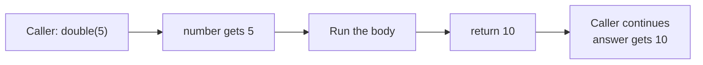

<div class="absolute inset-0 bg-[#E8522A]" />

<div class="absolute top-6 left-8 flex items-center gap-3 text-white">
  <div class="w-10 h-10 bg-white rounded flex items-center justify-center">
    <svg viewBox="0 0 40 40" class="w-8 h-8" fill="#E8522A" xmlns="http://www.w3.org/2000/svg" role="img" aria-label="ReDI School logo">
      <rect x="4" y="4" width="14" height="14" rx="1"/>
      <rect x="22" y="4" width="14" height="14" rx="1"/>
      <rect x="4" y="22" width="14" height="14" rx="1"/>
      <rect x="22" y="22" width="14" height="14" rx="1"/>
    </svg>
  </div>
  <span class="text-lg font-semibold tracking-wide">ReDISchool</span>
</div>
<div class="absolute top-8 right-8 text-white text-lg font-medium">Week 7</div>

<div class="absolute bottom-32 left-12 right-12 text-white">
  <p class="text-xl font-light opacity-90 mb-2">Introduction to Programming - Fall 2026</p>
  <h1 class="text-6xl font-light leading-tight mb-6">Functions</h1>
  <p class="text-2xl font-light opacity-90 mt-4">Write a piece of code once. Give it inputs. Use its result.</p>
  <p class="text-xl font-light opacity-90 mt-4">Write our own functions, use functions from libraries, and build a Hangman word game.</p>
</div>

---

<div class="text-sm font-semibold text-[#E8522A] uppercase tracking-widest mb-4">Week 7 - Functions</div>

## Part 1: Writing functions

From a named block of code to a result you can use.

<div class="agenda [&_td]:py-1">

|  |  |
|---|---|
| 01 | Quick recap |
| 02 | What is a function? |
| 03 | Defining and calling |
| 04 | Parameters and arguments |
| 05 | Return values |
| 06 / 07 | Execution and scope |

</div>

Practice: draw a face, check a shopping budget, and trace a function.

---

# 01 - Quick recap

We can store several values and work through them with a loop.

```python
scores = [12, 18, 24]          # A list
person = ("Mina", 20)         # A tuple

total = 0
for score in scores:
    total += score

print(total)                 # 54
print(person[0])             # Mina
```

Today, we will put code like this inside **functions**.

---

# 02 - What is a function?

A named piece of code that performs a task.
You already call functions:

```python
name = input("Your name: ")
print(name)
print(len(name))
```

| Function | What it does |
|---|---|
| `input()` | Reads text and gives it back to us |
| `print()` | Displays something |
| `len()` | Gives us the length of something |

Some functions take inputs. Some give us a useful result.

---

# Why write our own?

Imagine using the same code in several places.

- Give that task a clear name.
- Call it whenever you need it.
- Change its code in one place instead of many.

```python
show_menu()
```

A name such as `show_menu` tells us what the code is for.
Next, we will learn how to write that function.

---

# 03 - Defining and calling

Defining writes the instructions. Calling runs them.

```python
def show_menu():
    print("1. Play")
    print("2. Quit")
```

| Part | Meaning |
|---|---|
| `def` | Start a function definition |
| `show_menu` | The name we choose |
| `()` | Where parameters will go |
| `:` | The indented block starts next |
| Indented lines | The **body**: instructions indented by four spaces |

---

# A definition is not a call

```python
def show_menu():
    print("1. Play")
    print("2. Quit")

print("Welcome!")
show_menu()
print("Choose an option.")
```

```text
Welcome!
1. Play
2. Quit
Choose an option.
```

Python runs the body only when it reaches `show_menu()`.

---

# Call it again

```python
def show_menu():
    print("1. Play")
    print("2. Quit")

show_menu()
show_menu()
```

Each call starts the body again.

Write the definition before the first call runs.
Use parentheses to call a function: `show_menu()`, not just `show_menu`.

---

# 04 - Parameters and arguments

Run the same instructions with different inputs.

```python
def show_score(score):
    print(f"Score: {score}")

show_score(12)
show_score(30)
```

```text
Score: 12
Score: 30
```

**Parameter:** the name in the definition, such as `score`.

**Argument:** the value supplied by a call, such as `12`.

---

# More than one input

```python
def show_score(name, score):
    print(f"{name}: {score}")

show_score("Mina", 12)
show_score("Sam", 30)
```

Arguments are matched to parameters **in order**.

You can also use their names:

```python
show_score(score=12, name="Mina")
```

These are **keyword arguments**. The names must match the definition.

---

# A default value

```python
def show_score(name, score=0):
    print(f"{name}: {score}")

show_score("Mina")       # Mina: 0
show_score("Sam", 30)    # Sam: 30
```

The default is used only when that argument is omitted.

Put parameters without defaults before parameters with defaults.

---
class: knowledge-check-slide exercise-slide
---

# Exercise: Draw a face · 10 min

Write `draw_face(eyes, mouth)`.

- Print the eyes twice, with a space between them.
- Print the mouth on the next line, with one space before it.
- Call it twice with different characters. Choose your own!

Examples:

<div class="grid grid-cols-2 gap-8">
<div>

`draw_face("o", "-")`

```text
o o
 -
```

</div>
<div>

`draw_face("^", "v")`

```text
^ ^
 v
```

</div>
</div>

Folder: [exercises/07-functions/draw-a-face/](https://github.com/BazookaMusic/redi-intro-to-programming-2026/tree/main/exercises/07-functions/draw-a-face)

<!-- solution:start -->
---
class: knowledge-check-slide knowledge-solution-slide
---

# Solution: Draw a face

```python
def draw_face(eyes, mouth):
    print(f"{eyes} {eyes}")
    print(f" {mouth}")

draw_face("o", "-")
draw_face("^", "v")
```

```text
o o
 -
^ ^
 v
```

The function stays the same; its arguments change the face.
<!-- solution:end -->

---

# 05 - Return values

Give a result back to the code that called the function.

```python
def double(number):
    return number * 2

points = double(8)
print(points)                # 16
print(points + 5)            # 21
```

`double(8)` gives back `16`.

The code making the call is the **caller**.
It can save the returned value, calculate with it, or use it in a condition.

---

# `print` and `return` are different

<div class="grid grid-cols-2 gap-8">
<div>

## Display a value

```python
def show_double(number):
    print(number * 2)

result = show_double(8)
print(result)
```

```text
16
None
```

</div>
<div>

## Give back a value

```python
def double(number):
    return number * 2

result = double(8)
print(result + 5)
```

```text
21
```

</div>
</div>

Without an explicit `return`, a function returns `None`: no useful value.

---

# `return` ends the call

```python
def ticket_price(age):
    if age < 12:
        return 5
    return 10

print(ticket_price(8))       # 5
print(ticket_price(16))      # 10
```

Once Python reaches a `return`, it goes back to the caller.

For age `8`, the second `return` is never reached.

---
class: knowledge-check-slide exercise-slide
---

# Exercise: Shopping budget · 10 min

You are building the code for a wallet. The wallet starts with **20 euros**.
You will buy different items with it and check whether you can afford them.

1. Write `total_price(unit_price, quantity)`. It **returns** a number: the cost of **quantity** items at **unit_price** each.
2. A notebook costs 3 euros. Print the total for 4 and for 8 notebooks.
3. **(Advanced)** Make a basket: a list of `(price, quantity)` tuples. Write `can_afford(shopping_basket, wallet_amount)`. It **returns** `True` if the wallet can pay for the whole basket, otherwise `False`.

<div class="grid grid-cols-2 gap-6">
<div>

**Expected input and output**

```python
basket = [(3, 4), (2, 3)]
total_price(3, 4)       # returns 12
total_price(3, 8)       # returns 24
can_afford(basket, 20)  # returns True
can_afford(basket, 10)  # returns False
```

</div>
<div>

**Help:** loop over a list of tuples

```python
for unit_price, quantity in basket:
    print(unit_price, quantity)
```

Starter: [exercises/07-functions/shopping-budget/](https://github.com/BazookaMusic/redi-intro-to-programming-2026/tree/main/exercises/07-functions/shopping-budget)

</div>
</div>

<!-- solution:start -->
---
class: knowledge-check-slide knowledge-solution-slide
---

# Solution: Shopping budget

```python
def total_price(unit_price, quantity):
    return unit_price * quantity

print(total_price(3, 4))
print(total_price(3, 8))

def can_afford(shopping_basket, wallet_amount):
    total = 0
    for unit_price, quantity in shopping_basket:
        total += total_price(unit_price, quantity)
    return total <= wallet_amount
```

`can_afford` reuses the value that `total_price` returns.
If `total_price` only printed it, we could not add it up.
<!-- solution:end -->

---

# 06 - How a function runs

Follow a call from start to finish.

```python
def double(number):
    result = number * 2
    return result

answer = double(2 + 3)
print(answer)
```

1. Python defines `double`; it does not run the body yet.
2. It calculates the argument: `2 + 3` gives `5`.
3. It enters the function: the parameter `number` has value `5`.
4. It calculates `result`, then returns `10`.
5. The caller saves `10` in `answer` and prints it.

---

# The path of a call



The caller waits for the function's result before continuing.

If the body reaches its end without a `return`, the result is `None`.

---

# One function can call another

```python
def double(number):
    return number * 2

def double_plus_one(number):
    result = double(number)
    return result + 1

answer = double_plus_one(3)
print(answer)                # 7
```

`double_plus_one(3)` calls `double(3)` inside its body.

`double(3)` returns `6`. Then `double_plus_one` adds `1` and returns `7`.
Both functions can also be called on their own.

---

# 07 - Variable scope

Scope means where a variable name can be used.

```python
def double(number):
    result = number * 2
    return result

answer = double(4)
print(answer)                # 8
```

`number` and `result` are **local**: their names belong to this function call.

`answer` belongs to the code outside the function.
Returning `8` does not make the name `result` available outside.

---

# A local name is not available outside

```python
def double(number):
    result = number * 2
    return result

answer = double(4)
print(result)                # NameError
```

The caller received the **value**, not the function's local variable name.

Use `answer` here, not `result`.

---

# Same name, different variables

```python
score = 10                   # A global name: outside functions

def show_score():
    score = 3                # A local name: inside this call
    print(score)

show_score()                 # 3
print(score)                 # 10
```

Assignment inside the function normally creates a local variable.
It does not reassign the global `score`.

---

# Each call has its own local names

```python
def first_point():
    points = 0
    points += 1
    return points

print(first_point())         # 1
print(first_point())         # 1
```

The second call starts again at `points = 0`.

Local variables are not shared between separate calls.

---

# Reading a global name

```python
school = "ReDI"

def show_school():
    print(school)

show_school()                # ReDI
```

A function can read a name defined outside it.

Usually, prefer an explicit input: `show_school(school)`.
Parameters and return values make a function's inputs and outputs easier to see.

---
class: knowledge-check-slide
---

# Trace execution and scope · 5 min

```python
value = 10

def add_two(value):
    result = value + 2
    print(result)
    return result

answer = add_two(1)
print(answer)
print(value)
```

What three lines are printed? Could we use `result` outside the function?

Task and answers are in the lesson's exercise and solution READMEs.

<!-- solution:start -->
---
class: knowledge-check-slide knowledge-solution-slide
---

# Solution: Execution and scope

```text
3
3
10
```

- Inside the call, the parameter `value` is `1`, so `result` is `3`.
- The caller saves the returned `3` in `answer`.
- The global `value` stays `10`.
- `result` is a local name. Using it outside would cause a `NameError`.
<!-- solution:end -->

---
layout: center
---

# Break

15 minutes

---

<div class="text-sm font-semibold text-[#E8522A] uppercase tracking-widest mb-4">Week 7 - Functions</div>

## Part 2: Reusing code

Document our functions, use libraries, and build a game.

<div class="agenda [&_td]:py-1">

|  |  |
|---|---|
| 08 | Docstrings |
| 09 | Libraries and imports |
| 10 | Installing with pip |
| 11 | Mini project: Hangman |
| 12 | Homework and questions |

</div>

---

# 08 - Docstrings

A **docstring** is a short description inside a function.
It is the first statement in the body.

```python
def double(number):
    """Return twice the supplied number."""
    return number * 2
```

Use triple quotes. Describe what the function does.

For longer functions, also explain their inputs and returned result.

---

# Read a function's help

```python
def double(number):
    """Return twice the supplied number."""
    return number * 2

help(double)
```

Python shows the function's name, parameters, and docstring.

Notice `help(double)`, **not** `help(double(4))`.
We want help about the function, not about its returned number.

---

# Comments and docstrings

```python
def circle_area(radius):
    """Return the area of a circle with this radius."""
    # The calculation goes here.
    pass
```

- A **docstring** tells callers what the function is for.
- A **comment** can explain a particular line of code.
- `pass` is a placeholder that does nothing. Replace it with working code.

A docstring can explain what a game function takes in and returns.

---

# 09 - Libraries and imports

We do not have to write everything ourselves.

A **library** is reusable code supplied for other programs to use.

A **module** is a unit of Python code we can import, often a `.py` file.
A library can contain several modules.

Python includes a **standard library**. It is installed with Python.

| Module | Useful for |
|---|---|
| `math` | Mathematical functions and constants |
| `random` | Random choices and numbers |

---

# Import a module

```python
import math

print(math.sqrt(25))         # 5.0
print(round(math.pi, 2))     # 3.14
```

`import math` makes the module available in this program.

A module has **members**: the names defined inside it.
Some are functions, like `math.sqrt`. Some are values, like `math.pi`.

The dot means "use this member of that module":
`math.sqrt` is the square-root function in `math`.

---

# Import a function by name

```python
from math import sqrt

print(sqrt(25))              # 5.0
```

Now we can call `sqrt()` without writing `math.`.
Import only the names you need. Avoid `from math import *`.

**Shorter name:** `as` gives an import an **alias**, another name to use.

```python
import random as rand

print(rand.randint(1, 6))
```

---

# Random choices and numbers

```python
import random

names = ["pikachu", "bulbasaur", "charmander"]
opponent = random.choice(names)
damage = random.randint(5, 15)

print(opponent)
print(damage)
```

`choice()` picks one item from a non-empty sequence.

`randint(5, 15)` gives an integer from **5 through 15**, including both ends.

The output can change each time we run the program.

---
class: knowledge-check-slide exercise-slide
---

# Exercise: Lunch picker · 10 min

You and your friends can never decide what to eat for lunch.
You will write a program that picks a lunch for you at random.

1. Import `random`. Write `pick_lunch(options)`. It takes a list of foods and **returns** one of them, chosen at random.
2. Make a list called `foods` with at least three foods. Print the lunch that `pick_lunch` chooses from it.
3. **(Advanced)** Write `plan_week(options, days)`. It **returns** a list with one random lunch for each day, so the list has `days` items. Use `pick_lunch` inside it.

<div class="grid grid-cols-2 gap-6">
<div>

**Expected input and output** (random)

```python
foods = ["pizza", "sushi", "falafel"]
pick_lunch(foods)
# returns "sushi" (or another food)
plan_week(foods, 3)
# returns ["pizza", "pizza", "falafel"]
```

Your program prints one food, e.g. `sushi`

</div>
<div>

**Help**

```python
import random
print(random.choice(["heads", "tails"]))
# heads or tails
```

Starter: [exercises/07-functions/lunch-picker/](https://github.com/BazookaMusic/redi-intro-to-programming-2026/tree/main/exercises/07-functions/lunch-picker)

</div>
</div>

<!-- solution:start -->
---
class: knowledge-check-slide knowledge-solution-slide
---

# Solution: Lunch picker

```python
import random

def pick_lunch(options):
    return random.choice(options)

foods = ["pizza", "sushi", "falafel"]
print(pick_lunch(foods))

def plan_week(options, days):
    lunches = []
    for day in range(days):
        lunches.append(pick_lunch(options))
    return lunches
```

Python already supplies `random`; we do not need to install it.
<!-- solution:end -->

---

# What is Hangman?

Guess a **secret word**, one letter at a time. Correct guesses reveal letters.
Each wrong guess moves a skeleton one step closer to the player.


Reveal the word to win. After **six wrong guesses**, the skeleton reaches you
and you lose. Our Python game shows this in the terminal.

---

# 10 - Installing with pip

Install a library that does not come with Python, then import it.

**pip** installs Python packages.
A **package** is an installable bundle of code and other files.

We will use `english-words` to get a collection of English words for Hangman.

- Install it once on your computer.
- Import it in each program that uses it.
- Installation needs internet access. The word collection works offline.

Installing a package does **not** run it in your program.
Importing a missing package causes `ModuleNotFoundError`.

---

# Install `english-words`

Open your exercise folder in VS Code and choose **Terminal → New Terminal**.

<div class="grid grid-cols-2 gap-8">
<div>

## Windows (PowerShell)

```powershell
py -m pip install english-words==2.0.2
```

Then run your code:

```powershell
py exercise.py
```

</div>
<div>

## macOS

```sh
python3 -m pip install english-words==2.0.2
```

Then run your code:

```sh
python3 exercise.py
```

</div>
</div>

`-m pip` installs the package for the same Python that runs your code.

---

# Get English words for our game

```python
import random
from english_words import get_english_words_set

word_set = get_english_words_set(["web2"], lower=True)
words = list(word_set)
word = random.choice(words)
print(word)                 # a different word each time
```

The library includes a dictionary's word collection, not definitions.
`"web2"` selects the collection; `lower=True` makes the words lowercase.

The function **returns** a **set**, a collection without duplicates.
`list()` converts it to a list so `random.choice()` can pick an item.

---
class: knowledge-check-slide exercise-slide
---

# Exercise: Words for Hangman · 10 min

Our Hangman game needs words that are not too long or too short.
For this task, use a small list of words before connecting the library.

1. Write `game_words(words)`. It **returns** a list containing only words with 4 to 8 letters, including both ends.
2. Print the result for `["cat", "apple", "banana", "watermelon"]`.
3. **(Advanced)** Write `pick_word(words)`. It **returns** a random word from `game_words(words)`. Assume at least one word fits.

<div class="grid grid-cols-2 gap-6">
<div>

**Expected input and output**

```python
game_words(["cat", "apple", "banana", "watermelon"])
# returns ["apple", "banana"]
pick_word(["cat", "apple", "banana"])
# returns "apple" or "banana"
```

Your program prints: `['apple', 'banana']`

</div>
<div>

**Help:** build a list with a loop

```python
result = []
for word in words:
    if 4 <= len(word) <= 8:
        result.append(word)
```

Starter: [exercises/07-functions/hangman-words/](https://github.com/BazookaMusic/redi-intro-to-programming-2026/tree/main/exercises/07-functions/hangman-words)

</div>
</div>

<!-- solution:start -->
---
class: knowledge-check-slide knowledge-solution-slide
---

# Solution: Words for Hangman

```python
import random

def game_words(words):
    result = []
    for word in words:
        if 4 <= len(word) <= 8:
            result.append(word)
    return result

print(game_words(["cat", "apple", "banana", "watermelon"]))

def pick_word(words):
    return random.choice(game_words(words))
```
<!-- solution:end -->

---

# 11 - Mini project: Hangman

Now put the pieces together. Choose an eight-letter word, reveal guessed
letters and check for victory. A skeleton shows how many mistakes are left.

The game repeats: show the word, read a guess, then update the game.

```text
________
💀______😊
Guess a letter: i
Correct!
_i___i__
💀______😊
Guess a letter: z
Wrong guess!
_i___i__
_💀_____😊
```

---
class: knowledge-check-slide exercise-slide
---

# Exercise: Hangman · 20 min

Copy the code from the starter: [exercise.py](https://github.com/BazookaMusic/redi-intro-to-programming-2026/blob/main/exercises/07-functions/mini-project-hangman/exercise.py). The word picker, lives bar and game loop are supplied.

1. Write `victory(word)`: **return** `True` if there is no `_`, otherwise `False`.
2. Write `display_hidden_word(secret_word, guessed_letters)`: **return** the word with `_` for unguessed letters.
3. Write `get_user_guess(guessed_letters)`: ask until a new `a`–`z` letter is entered; **return** it lowercase.

<div class="grid grid-cols-2 gap-6">
<div>

**Expected input and output**

```python
display_hidden_word("linguist", ["i"])
# "_i___i__"
victory("_i___i__")             # False
get_user_guess(["i"])           # " A " → "a"
lives_bar(6, 5)                 # "_💀_____😊"
```

</div>
<div>

**Help:** loop over letters

```python
for letter in secret_word:
    if letter in guessed_letters:
        print(letter)
guess = input("Letter: ").strip().lower()
```

</div>
</div>

<!-- solution:start -->
---
class: knowledge-check-slide knowledge-solution-slide
---

# Supplied code: Choose a secret word

```python
def get_random_secret_word(length):
    """Gets a random secret word for our game."""
    web2lowerset = get_english_words_set(["web2"], lower=True)
    result = []
    for word in web2lowerset:
        if word.isascii() and word.isalpha() and len(word) == length:
            result.append(word)
    if not result:
        raise ValueError(f"No English words found with {length} letters.")
    return random.choice(result)
```

`isascii()` and `isalpha()` keep words made of letters from `a` to `z`.
<!-- solution:end -->

<!-- solution:start -->
---
class: knowledge-check-slide knowledge-solution-slide
---

# Solution: Reveal letters and check victory

```python
def display_hidden_word(secret_word, guessed_letters):
    """Returns underscores for unguessed letters."""
    display = ""
    for letter in secret_word:
        if letter in guessed_letters:
            display += letter
        else:
            display += "_"
    return display

def victory(word):
    """Returns True when no letters are hidden."""
    return "_" not in word
```
<!-- solution:end -->

<!-- solution:start -->
---
class: knowledge-check-slide knowledge-solution-slide
---

# Solution: Read a new letter

```python
def get_user_guess(guessed_letters):
    """Returns a new letter in lowercase."""
    while True:
        guess = input("Guess a letter: ").strip().lower()
        if len(guess) != 1 or guess not in "abcdefghijklmnopqrstuvwxyz":
            print("Not a letter. Try again.")
        elif guess in guessed_letters:
            print("You have already guessed this letter.")
        else:
            return guess
```
<!-- solution:end -->

<!-- solution:start -->
---
class: knowledge-check-slide knowledge-solution-slide
---

# Supplied code: The lives bar

```python
def lives_bar(total_lives, lives_left):
    """Moves the skeleton towards the player."""
    skeleton_position = total_lives - lives_left
    lives_display = ""
    for i in range(skeleton_position):
        lives_display += "_"
    lives_display += "💀"
    for i in range(total_lives - skeleton_position):
        lives_display += "_"
    lives_display += "😊"
    return lives_display
```

The starter already prints `lives_bar(total_lives, lives_left)` inside `hangman()`.
The full solved game is in the matching `solutions/` folder.
<!-- solution:end -->

---

# 12 - Homework

Four short tasks. Each has an `exercise.py` and its own `check.py`.

| Task | Practise |
|---|---|
| 1. Ticket prices | Parameters, conditions and returning a price |
| 2. High scores | A list parameter and a loop |
| 3. Average score | Returning a calculation for the caller to use |
| 4. Roll a die | Default parameters, a library and a docstring |

Folder: [exercises/07-functions/](https://github.com/BazookaMusic/redi-intro-to-programming-2026/tree/main/exercises/07-functions)

---
class: knowledge-check-slide exercise-slide
---

# Homework 1: Ticket prices

Write `ticket_price(age)`.

- Return `5` if the age is below `12`.
- Otherwise return `10`.
- Print the returned prices for ages `8` and `16`.
- Add those two returned prices and print the total.

```text
5
10
15
```

Folder: `homework-01-ticket-prices/`

<!-- solution:start -->
---
class: knowledge-check-slide knowledge-solution-slide
---

# Solution: Ticket prices

```python
def ticket_price(age):
    if age < 12:
        return 5
    return 10

child = ticket_price(8)
adult = ticket_price(16)
print(child)
print(adult)
print(child + adult)
```
<!-- solution:end -->

---
class: knowledge-check-slide exercise-slide
---

# Homework 2: High scores

Write `count_high_scores(scores, minimum)`.

Use a loop to count scores **greater than or equal to** `minimum`.
Return the count.

Use `[12, 45, 7, 30]` and a minimum of `20`. Print the result.

```text
2
```

Folder: `homework-02-high-scores/`

<!-- solution:start -->
---
class: knowledge-check-slide knowledge-solution-slide
---

# Solution: High scores

```python
def count_high_scores(scores, minimum):
    count = 0
    for score in scores:
        if score >= minimum:
            count += 1
    return count

print(count_high_scores([12, 45, 7, 30], 20))
```
<!-- solution:end -->

---
class: knowledge-check-slide exercise-slide
---

# Homework 3: Average score

Write `average(scores)`. Assume the list is non-empty.

Use a loop to find the total, then return `total / len(scores)`.

Call it with `[12, 18, 24]`. Print the result.
If it is at least `15`, also print `Pass`.

```text
18.0
Pass
```

Folder: `homework-03-average-score/`

<!-- solution:start -->
---
class: knowledge-check-slide knowledge-solution-slide
---

# Solution: Average score

```python
def average(scores):
    total = 0
    for score in scores:
        total += score
    return total / len(scores)

result = average([12, 18, 24])
print(result)
if result >= 15:
    print("Pass")
```
<!-- solution:end -->

---
class: knowledge-check-slide exercise-slide
---

# Homework 4: Roll a die

Import `random`. Write `roll_die(sides=6)` with a docstring.

Return a random integer from `1` through `sides`, including both ends.

Print one roll using the default and one using `sides=20`.

One possible output:

```text
4
17
```

Folder: `homework-04-roll-a-die/`

<!-- solution:start -->
---
class: knowledge-check-slide knowledge-solution-slide
---

# Solution: Roll a die

```python
import random

def roll_die(sides=6):
    """Return a random integer from 1 through sides."""
    return random.randint(1, sides)

print(roll_die())
print(roll_die(sides=20))
```

The output changes. The checker tests the range and both endpoints.
<!-- solution:end -->

---

# The main ideas

- **Define** a function with `def`; **call** it with parentheses.
- **Parameters** name the inputs; **arguments** supply their values.
- **Return** gives a result to the caller; **print** displays something.
- **Scope** determines where a variable name is available.
- **Docstrings** describe what a function does.
- **Import** reusable code; **pip** installs additional packages.

Use small functions with clear inputs and useful results.

---
layout: center
---

# Questions?
