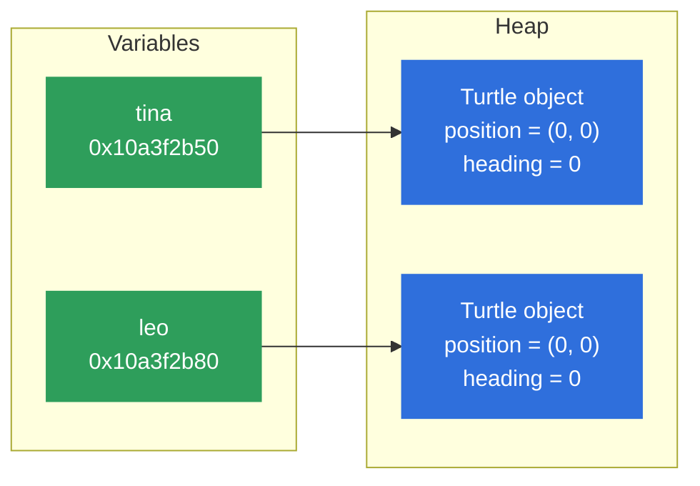
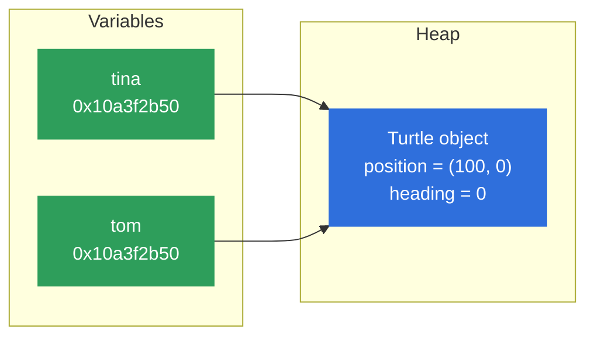
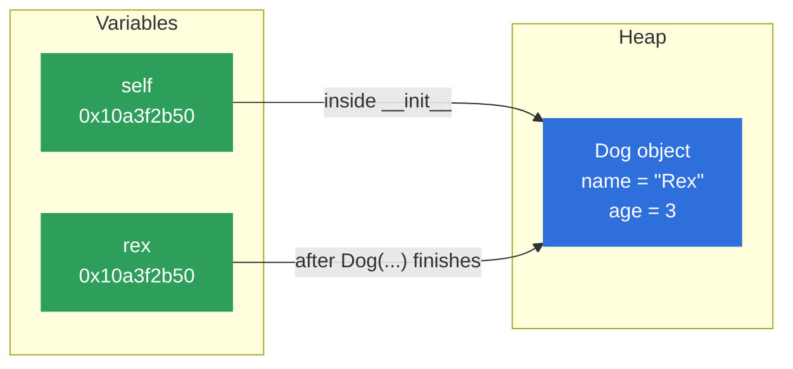

<style>
/* The default theme greys out the first paragraph under a title; keep it readable. */
:global(.slidev-layout h1 + p) {
  opacity: 1;
}
</style>

<div class="absolute inset-0 bg-[#E8522A]" />

<div class="absolute top-6 left-8 flex items-center gap-3 text-white">
  <div class="w-10 h-10 bg-white rounded flex items-center justify-center">
    <svg viewBox="0 0 40 40" class="w-8 h-8" fill="#E8522A" xmlns="http://www.w3.org/2000/svg" role="img" aria-label="ReDI School logo">
      <rect x="4" y="4" width="14" height="14" rx="1"/>
      <rect x="22" y="4" width="14" height="14" rx="1"/>
      <rect x="4" y="22" width="14" height="14" rx="1"/>
      <rect x="22" y="22" width="14" height="14" rx="1"/>
    </svg>
  </div>
  <span class="text-lg font-semibold tracking-wide">ReDISchool</span>
</div>
<div class="absolute top-8 right-8 text-white text-lg font-medium">Week 9</div>

<div class="absolute bottom-32 left-12 right-12 text-white">
  <p class="text-xl font-light opacity-90 mb-2">Introduction to Programming - Fall 2026</p>
  <h1 class="text-6xl font-light leading-tight mb-6">Classes and files</h1>
  <p class="text-2xl font-light opacity-90 mt-4">Keep data and actions together. Keep data for next time.</p>
  <p class="text-xl font-light opacity-90 mt-4">Write your own classes, then read and write text files.</p>
</div>

---

# What we'll learn today

1. **Classes and objects:** keep a thing's data and its actions together.
2. **Files:** read a text file, write a new one, and add lines to it.
3. **Your project:** start thinking about your own project idea.

---

<div class="text-sm font-semibold text-[#E8522A] uppercase tracking-widest mb-4">Week 9 - Classes and files</div>

## Part 1: Classes and objects

Keep a thing's data and its actions together.

<div class="agenda [&_td]:py-1">

|  |  |
|---|---|
| 01 | Quick recap |
| 02 | What is an object? |
| 03 | Where do objects live? |
| 04 | Making our own objects - Class |
| 05 | Your first class |
| 06 | `__init__` and `self` |
| 07 | Methods |
| 08 | When to use a class? |

</div>

Practice: a wallet.

---

# 01 - Quick recap

Last week, we could store a dog in a dictionary and write functions for it.

```python
dog = {"name": "Rex", "age": 3, "hungry": True}

def describe(dog):
    print(f"{dog['name']} is {dog['age']} years old")

def feed(dog):
    dog["hungry"] = False

describe(dog)          # Rex is 3 years old
feed(dog)
print(dog["hungry"])   # False
```

The data is in the dictionary. The actions are separate functions.
The data and the actions live apart.

---

# 02 - What is an object?

A dog **has** things and **does** things.

**A dog has:** a name, an age, hungry or not<br>
**A dog does:** bark, eat

| Word | Meaning |
|---|---|
| **Object** | A value in your program that holds data and can do actions |
| **Attribute** | Something the object **has**, such as its name |
| **Method** | Something the object **does**, such as bark |
| **State** | The values of its attributes right now. After the dog eats, it is no longer hungry. |

---

# Objects in code

You have already used objects.

<div class="grid grid-cols-2 gap-8 items-start">
<div>

```python
name = "rex"
print(name.upper())   # REX
print(type(name))     # <class 'str'>
```

</div>
<div>

```python
dogs = ["Rex"]
dogs.append("Bella")
print(dogs)           # ['Rex', 'Bella']
print(type(dogs))     # <class 'list'>
```

</div>
</div>

`.upper()` and `.append()` are **methods**.
`str` and `list` are **classes**.

`type()` tells you which class an object was made from. Today you will write your own class.

---

# An object has state

**State** means the values an object holds right now. Its methods can change them.

<div class="grid grid-cols-2 gap-8 items-start">
<div>

```python
import turtle

tina = turtle.Turtle()       # a new turtle object
tina.shape("turtle")
tina.shapesize(3)            # 3 times bigger
print(tina.position())       # (0.00,0.00)
print(tina.heading())        # 0.0

tina.forward(100)            # moves and draws a line
tina.left(90)                # turns left
print(tina.position())       # (100.00,0.00)
print(tina.heading())        # 90.0

print(type(tina))            # <class 'turtle.Turtle'>
turtle.done()                # keeps the window open
```

</div>
<div>

`Turtle` is a class from the `turtle` library.

The state of `tina` is her position and her direction.

- `forward()` changes her position.
- `left()` changes her direction.

`tina` remembers her new state, so later code sees it.

</div>
</div>

---

# 03 - Where do objects live?

<div class="grid grid-cols-2 gap-8 items-start">
<div>

```python
tina = turtle.Turtle()
leo = turtle.Turtle()
print(tina)
```

```text
<turtle.Turtle object at 0x10a3f2b50>
```

Each `turtle.Turtle()` makes a new object on the **heap**. `0x10a3f2b50` is its **address**.

</div>
<div>



A variable does not hold the object. It holds the object's **address**.

</div>
</div>

<div class="mt-4" role="img" aria-label="Memory drawn as a row of numbered boxes. Box 0x10a3f2b50 holds tina's Turtle object and box 0x10a3f2b80 holds leo's Turtle object. The other boxes are empty.">
<div class="grid grid-cols-6 gap-2 text-center text-sm">
<div class="rounded border border-gray-500 py-2 opacity-60"><div class="font-mono text-xs">0x10a3f2b30</div><div>empty</div></div>
<div class="rounded border border-gray-500 py-2 opacity-60"><div class="font-mono text-xs">0x10a3f2b40</div><div>empty</div></div>
<div class="rounded py-2 bg-[#2f6fdc] text-white"><div class="font-mono text-xs">0x10a3f2b50</div><div>tina's Turtle</div></div>
<div class="rounded border border-gray-500 py-2 opacity-60"><div class="font-mono text-xs">0x10a3f2b60</div><div>empty</div></div>
<div class="rounded border border-gray-500 py-2 opacity-60"><div class="font-mono text-xs">0x10a3f2b70</div><div>empty</div></div>
<div class="rounded py-2 bg-[#2f6fdc] text-white"><div class="font-mono text-xs">0x10a3f2b80</div><div>leo's Turtle</div></div>
</div>
<p class="text-sm mt-2">Memory is a long row of boxes, and each box has a number: its <strong>address</strong>. The heap is the part of memory where Python keeps objects.</p>
</div>

---

# Two names, one object

<div class="grid grid-cols-2 gap-8 items-start">
<div>

```python
tina = turtle.Turtle()
tom = tina        # no new turtle is made

tom.forward(100)
print(tina.position())
```

```text
(100.00,0.00)
```

`tom = tina` copies the **address**, not the turtle. Both names point to the same object, so when `tom` moves, `tina` moves too.

</div>
<div>



Want a second turtle? Call `turtle.Turtle()` again.

</div>
</div>

---

# 04 - Making our own objects - Class

A **class** is a template for making objects. It says what every object of that kind **has** and **does**.

<div class="grid grid-cols-2 gap-6 items-center">
<div>

Think of a **cookie cutter**. The cutter is not a cookie, but every cookie you press out with it has the same shape.
Each cookie is its own cookie, and you can decorate each one differently.

</div>


</div>

| Idea | Cookies | Python |
|---|---|---|
| **Class**: what every object has and does | the cutter | `Dog`: a name, an age, can bark |
| **Instance**: an object made from the class | one cookie | `rex`: Rex, age 3 |
| Another **instance** | another cookie | `bella`: Bella, age 5 |

One class, many objects. They have the same parts, but each one has its own values.

---

# 05 - Your first class

```python
class Dog:
    pass

rex = Dog()
bella = Dog()

rex.name = "Rex"
rex.age = 3
bella.name = "Bella"

print(rex.name)      # Rex
print(bella.age)     # crashes!
```

```text
AttributeError: 'Dog' object has no attribute 'age'
```

- `class Dog:` creates a class. Class names start with a capital letter.
- `pass` means "nothing here yet". `Dog()` creates a new object.
- We forgot Bella's age. We need a way to fill in every box when we create a dog.

---

# 06 - `__init__` and `self`

<div class="grid grid-cols-2 gap-8 items-start">
<div>

```python
class Dog:
    def __init__(self, name, age):
        self.name = name
        self.age = age

rex = Dog("Rex", 3)
```



`self` and `rex` hold the same **address**, so they are two names for the same dog.

</div>
<div>

**`__init__`: the setup method**

Python runs it **automatically** every time you create an object, for example `Dog("Rex", 3)`. It gives the new object its starting **attributes**. It has **two underscores** on each side.

**`self`: the object itself**

`self` is the object being set up. When we create Rex, `self` is Rex.

`self.name = name` means "save the name we were given inside this object".

</div>
</div>

---

# What happens on `Dog("Rex", 3)`?

```python
rex = Dog("Rex", 3)
bella = Dog("Bella", 5)

print(rex.name, rex.age)        # Rex 3
print(bella.name, bella.age)    # Bella 5
```

1. Python creates a new, empty `Dog` object.
2. It runs `__init__`: `self` is the new object, `name` is `"Rex"`, `age` is `3`.
3. `self.name = name` saves `"Rex"` in the object.
4. The new object is stored in `rex`.

We never pass `self` ourselves. Python does it for us.

---
class: knowledge-check-slide
---

# Predict the output

```python
class Dog:
    def __init__(self, name, age):
        self.name = name
        self.age = age

rex = Dog("Rex", 3)
bella = Dog("Bella", 5)
bella.age = 6

print(rex.age)
print(bella.name, bella.age)
```

What two lines are printed?

<!-- solution:start -->
---
class: knowledge-check-slide knowledge-solution-slide
---

# Solution: Predict the output

```text
3
Bella 6
```

- `bella.age = 6` changes only Bella's age.
- Rex is a different object, so his age is still `3`.
<!-- solution:end -->

---
class: knowledge-check-slide exercise-slide
---

# Exercise: Wallet · 10 min

You are building a wallet. Every wallet has an owner and an amount of money in Danish Kroner.

1. Write a class `Wallet`. It should be initialized with an `owner` (string) and `money` (a number) and saves them as attributes.
2. Create a wallet for "Ana" with 200 DKK and a wallet for "Ben" with 125 DKK.
3. Print each wallet's owner and money.
4. **(Advanced)** Put both wallets in a list and use a loop to print every owner and their money.

<div class="grid grid-cols-2 gap-6 [&_td]:py-1 [&_th]:py-1">
<div>

**Expected input and output**

| Code | Output |
|---|---|
| `ana = Wallet("Ana", 200)`<br>`print(ana.owner)` | `Ana` |
| `print(ana.money)` | `200` |
| `ben = Wallet("Ben", 125)`<br>`print(ben.money)` | `125` |
| Advanced loop | `Ana has 200 DKK`<br>`Ben has 125 DKK` |

</div>
<div>

**Help**

```python
class Dog:
    def __init__(self, name, age):
        self.name = name
        self.age = age

rex = Dog("Rex", 3)
print(rex.name)
```

Starter: [exercises/09-classes-and-files/wallet/](https://github.com/BazookaMusic/redi-intro-to-programming-2026/tree/main/exercises/09-classes-and-files/wallet)

</div>
</div>

<!-- solution:start -->
---
class: knowledge-check-slide knowledge-solution-slide
---

# Solution: Wallet

```python
class Wallet:
    def __init__(self, owner, money):
        self.owner = owner
        self.money = money

ana = Wallet("Ana", 200)
ben = Wallet("Ben", 125)

print(ana.owner, ana.money)
print(ben.owner, ben.money)

wallets = [ana, ben]
for wallet in wallets:
    print(f"{wallet.owner} has {wallet.money} DKK")
```
<!-- solution:end -->

---

# 07 - Methods

A **method** is a function inside a class. Its first parameter is `self`.

```python
class Dog:
    def __init__(self, name):
        self.name = name
        self.hungry = True

    def bark(self):
        print(f"{self.name} says Woof!")

    def eat(self):
        self.hungry = False

rex = Dog("Rex")
bella = Dog("Bella")
rex.bark()             # Rex says Woof!
rex.eat()
print(rex.hungry)      # False
print(bella.hungry)    # True
```

In `rex.eat()`, `self` is `rex`. So `self` gives the method access to **this** object's attributes.

---

# Return a value or change an attribute

```python
class Dog:
    # __init__, bark and eat as before

    def is_hungry(self):
        return self.hungry

    def feed_if_hungry(self):
        if self.is_hungry():
            self.eat()
```

| Method | What it does |
|---|---|
| `is_hungry()` | **Returns** a value. It changes nothing. |
| `eat()` | **Changes** an attribute. It returns nothing. |
| `feed_if_hungry()` | Calls other methods of the same object with `self.` |

```python
rex = Dog("Rex")
rex.feed_if_hungry()
print(rex.is_hungry())    # False
```

---
class: knowledge-check-slide exercise-slide
zoom: 0.9
---

# Exercise: Wallet methods · 15 min

Copy the code from the starter if you need it: [wallet-methods/exercise.py](https://github.com/BazookaMusic/redi-intro-to-programming-2026/blob/main/exercises/09-classes-and-files/wallet-methods/exercise.py)

Our wallet is not useful yet. Let's allow it to receive money and pay for things.

1. Add a method `receive(amount)` that adds `amount` to `money`.
2. Add a method `has_enough_money(price)` that returns `True` if `money` is at least `price`, otherwise `False`.
3. Add a method `pay(price)`. If `money` is at least `price`, it subtracts `price` from `money` and returns `True`. Otherwise it returns `False` and does not change `money`.
4. **(Advanced)** Add a method `pay_all(prices)` that calls `pay` for each price in the list and returns how many prices were paid.

<div class="grid grid-cols-2 gap-6">
<div>

**Expected input and output**

```python
wallet = Wallet("Ana", 200)
wallet.receive(50)             # money 250
wallet.has_enough_money(300)   # False
wallet.pay(100)                # True, money 150
wallet.pay(400)                # False, money 150
wallet.pay_all([50, 200, 30])  # 2, money 70
```

</div>
<div>

**Help**

```python
class Dog:
    def eat(self):          # changes an attribute
        self.hungry = False

    def is_hungry(self):    # returns a value
        return self.hungry
```

</div>
</div>

<!-- solution:start -->
---
class: knowledge-check-slide knowledge-solution-slide
---

# Solution: Wallet methods

<div class="grid grid-cols-2 gap-6">
<div>

```python
class Wallet:
    def __init__(self, owner, money):
        self.owner = owner
        self.money = money

    def receive(self, amount):
        self.money += amount

    def has_enough_money(self, price):
        return self.money >= price
```

</div>
<div>

```python
    # still inside the class
    def pay(self, price):
        if self.has_enough_money(price):
            self.money -= price
            return True
        return False

    def pay_all(self, prices):
        paid = 0
        for price in prices:
            if self.pay(price):
                paid += 1
        return paid
```

</div>
</div>

`pay_all` reuses `pay`, so the check and the subtraction are written only once.
<!-- solution:end -->

---

# 08 - When to use a class?

| | Dictionary | Class |
|---|---|---|
| Create | `dog = {"name": "Rex", "age": 3}` | `rex = Dog("Rex", 3)` |
| Read a value | `dog["name"]` | `rex.name` |
| Actions | Separate functions: `feed(dog)` | Methods: `rex.eat()` |
| Same boxes every time? | Not checked | `__init__` fills them in |

- Use a **dictionary** for simple data that you look up by key.
- Use a **class** when the data and the actions belong together, or when you create many things of the same kind.

---
layout: center
---

# Break

15 minutes

---

<div class="text-sm font-semibold text-[#E8522A] uppercase tracking-widest mb-4">Week 9 - Classes and files</div>

## Part 2: Working with files

Keep data after the program ends.

<div class="agenda [&_td]:py-1">

|  |  |
|---|---|
| 09 | Why files? |
| 10 | Opening and closing a file |
| 11 | Reading a file |
| 12 | Writing |
| 13 | Adding to a file |

</div>

Practice: a shopping list file.

---

# 09 - Why files?

Variables disappear when the program ends.

A **file** keeps data for next time: a shopping list that is still there tomorrow.

We can also share data with someone else by giving them a file.

A **text file** is just lines of text (strings), like a `.txt` or `.py` file in VS Code.

```text
bread
milk
eggs
```

---

# Files and folders reminder

Every file lives inside a folder. A **path** says where the file is.

| | Path |
|---|---|
| Windows | `C:\Users\ana\redi\shopping.txt` |
| macOS | `/Users/ana/redi/shopping.txt` |

A plain name like `"shopping.txt"` means "the file in the folder my terminal is in".

1. In VS Code, open the exercise folder with `Open Folder...`.
2. Put the file next to `exercise.py`.
3. Open **Terminal → New Terminal** and run the program there:

```sh
python3 exercise.py    # macOS
py exercise.py         # Windows
```

---

# 10 - Opening and closing a file

<div class="grid grid-cols-2 gap-8">
<div>

```python
file = open("shopping.txt", "r")
text = file.read()
print(text)
file.close()
```

`open` gives back a **file object**. Like the objects in Part 1, it has methods: `.read()`, `.write()` and `.close()`.

</div>
<div>

| Mode | Meaning |
|---|---|
| `"r"` | **Read** the file |
| `"w"` | **Write** a new file (erases what was there first) |
| `"a"` | **Add** to the end of the file |

</div>
</div>

The file must be **closed** with `file.close()`.
Until then, Python keeps it open, and what you wrote may not be saved to the disk yet.

---

# The `with` block

```python
with open("shopping.txt", "r") as file:
    text = file.read()
    print(text)

print("The file is closed now")
```

With this pattern, Python makes sure the file is **closed** when the indented block ends.

From now on, we always use `with`.

---

# 11 - Reading a whole file

```python
with open("shopping.txt", "r") as file:
    text = file.read()  # "bread\nmilk\neggs\n"
```

<div class="grid gap-6 items-center mt-6" style="grid-template-columns: 1fr auto 1fr">
<div>

**The file** `shopping.txt`

```text
bread
milk
eggs
```

</div>
<div class="text-center">

`file.read()`

<div style="font-size: 3rem; line-height: 1">→</div>

</div>
<div>

**The string** in `text`

```python
"bread\nmilk\neggs\n"
```

</div>
</div>

`"\n"` means **new line**. When we `print(text)`, each `"\n"` becomes a line break again.

---

# Reading line by line

<div class="grid grid-cols-2 gap-8">
<div>

```python
with open("shopping.txt", "r") as file:
    for line in file:
        print(line)
```

```text
bread

milk

eggs

```

</div>
<div>

```python
with open("shopping.txt", "r") as file:
    for line in file:
        print(line.strip())
```

```text
bread
milk
eggs
```

</div>
</div>

`for line in file:` gives one line at a time. Each line still ends with `"\n"`, and `print` adds another new line.

`.strip()` (from lesson 04) removes the `"\n"`.

---

# Trace the loop

```python
with open("shopping.txt", "r") as file:
    for line in file:
        print(line.strip())
```

| Round | `line` | `line.strip()` |
|---|---|---|
| 1 | `"bread\n"` | `"bread"` |
| 2 | `"milk\n"` | `"milk"` |
| 3 | `"eggs\n"` | `"eggs"` |

The loop stops after the last line.

---

# Building a list from a file

```python
items = []
with open("shopping.txt", "r") as file:
    for line in file:
        item = line.strip()
        if item != "":
            items.append(item)

print(items)    # ['bread', 'milk', 'eggs']
```

- Start with an empty list `[]`.
- Add each line, without its `"\n"`, to the list.
- An empty line becomes `""` after `.strip()`, so we skip it.

---
class: knowledge-check-slide exercise-slide
zoom: 0.9
---

# Exercise: Shopping list · 10 min

You keep your shopping list in a file, one item per line. Write code that reads it.

1. In VS Code, make a new file `shopping_list.txt` next to your `exercise.py`. Type a few items into it by hand, one per line, and save it (see the example below).
2. Write the function `print_list(filename)`: **prints** every item, with no empty lines.
3. **(Advanced)** Write the function `has_item(filename, item)`: **returns** `True` if `item` is in the file, otherwise `False`.

<div class="grid grid-cols-2 gap-8 items-start">
<div>

**Expected input and output**

```text [shopping_list.txt]
bread
milk
eggs
```

```python
print_list("shopping_list.txt")  # prints:
# bread
# milk
# eggs
has_item("shopping_list.txt", "milk")    # True
has_item("shopping_list.txt", "cheese")  # False
```

</div>
<div>

**Help**

```python
with open(filename, "r") as file:
    for line in file:
        print(line.strip())
```

`.strip()` removes the `"\n"` at the end of a line.

For `has_item`, check `line.strip() == item`.

Starter: [exercises/09-classes-and-files/shopping-list/](https://github.com/BazookaMusic/redi-intro-to-programming-2026/tree/main/exercises/09-classes-and-files/shopping-list)

</div>
</div>

<!-- solution:start -->
---
class: knowledge-check-slide knowledge-solution-slide
---

# Solution: Shopping list

```python
def print_list(filename):
    with open(filename, "r") as file:
        for line in file:
            item = line.strip()
            if item != "":
                print(item)

print_list("shopping_list.txt")

def has_item(filename, item):
    with open(filename, "r") as file:
        for line in file:
            if line.strip() == item:
                return True
    return False
```
<!-- solution:end -->

---

# 12 - Writing

`"w"` opens a file for **writing**. `file.write()` puts text into the file.

```python
with open("shopping.txt", "w") as file:
    file.write("bread\n")
    file.write("milk\n")
```

<div class="grid gap-6 items-start mt-4" style="grid-template-columns: 1fr auto 1fr">
<div>

```text [Before: shopping.txt]
tea
```

</div>
<div class="text-center">

`"w"`

<div style="font-size: 3rem; line-height: 1">→</div>

</div>
<div>

```text [After: shopping.txt]
bread
milk
```

</div>
</div>

<div class="mt-6">

- `"w"` **erases** the old text first. If the file does not exist yet, `"w"` creates it.
- `.write()` does not start a new line by itself. Without `"\n"` we get `breadmilk`.

</div>

---

# 13 - Adding to a file

`"a"` opens a file for **adding** (a = append). New text goes at the **end**, and the old lines stay.

```python
with open("shopping.txt", "a") as file:
    file.write("eggs\n")
```

<div class="grid gap-6 items-start mt-4" style="grid-template-columns: 1fr auto 1fr">
<div>

```text [Before: shopping.txt]
bread
milk
```

</div>
<div class="text-center">

`"a"`

<div style="font-size: 3rem; line-height: 1">→</div>

</div>
<div>

```text [After: shopping.txt]
bread
milk
eggs
```

</div>
</div>

<div class="mt-6">

- Use `"a"` when you want to **keep** what is already in the file.
- If the file does not exist yet, `"a"` creates it.

</div>

---
class: knowledge-check-slide
---

# What is in `shopping.txt`?

```python
with open("shopping.txt", "w") as file:
    file.write("tea\n")

with open("shopping.txt", "a") as file:
    file.write("milk\n")

with open("shopping.txt", "w") as file:
    file.write("bread\n")

with open("shopping.txt", "a") as file:
    file.write("eggs\n")
```

What is in the file after these lines run?

<!-- solution:start -->
---
class: knowledge-check-slide knowledge-solution-slide
---

# Solution: What is in `shopping.txt`?

```text
bread
eggs
```

- The second `"w"` erased `tea` and `milk`, then wrote `bread`.
- The last `"a"` added `eggs` at the end.
<!-- solution:end -->

---
class: knowledge-check-slide exercise-slide
zoom: 0.9
---

# Exercise: Add to the shopping list · 10 min

Now you want to change your shopping list from Python. Write code that saves a new list and adds items to it.

1. Write the function `save_list(filename, items)`: `filename` is the name of the file, such as `"shopping.txt"`. `items` is a list of strings. It **writes** each item into the file, one per line. Anything already in the file is **replaced**.
2. Write the function `add_item(filename, item)`: `item` is one string. It **adds** `item` to the end of the file. The old items **stay**.
3. **(Advanced)** Write the function `add_items(filename, items)`: `items` is a list of strings. It **adds** each item to the end of the file. Use `add_item`.

<div class="grid grid-cols-2 gap-8 items-start">
<div>

**Expected input and output**

```python
save_list("shopping.txt", ["bread", "milk"])
add_item("shopping.txt", "eggs")
add_items("shopping.txt", ["cheese", "apples"])
```

```text [shopping.txt afterwards]
bread
milk
eggs
cheese
apples
```

</div>
<div>

**Help**

```python
with open(filename, "w") as file:
    file.write(item + "\n")
```

`"w"` replaces the file. `"a"` adds to the end.

Use a `for` loop to write every item in a list.

Starter: [exercises/09-classes-and-files/shopping-list-write/](https://github.com/BazookaMusic/redi-intro-to-programming-2026/tree/main/exercises/09-classes-and-files/shopping-list-write)

</div>
</div>

<!-- solution:start -->
---
class: knowledge-check-slide knowledge-solution-slide
---

# Solution: Add to the shopping list

```python
def save_list(filename, items):
    with open(filename, "w") as file:
        for item in items:
            file.write(item + "\n")

def add_item(filename, item):
    with open(filename, "a") as file:
        file.write(item + "\n")

def add_items(filename, items):
    for item in items:
        add_item(filename, item)
```

`save_list` uses `"w"`, so it replaces the old list. `add_item` uses `"a"`, so it keeps it.
<!-- solution:end -->

---

# Common mistakes

| Mistake | What you see | Fix |
|---|---|---|
| The file is not in the terminal's folder | `FileNotFoundError: [Errno 2] No such file or directory: 'shopping.txt'` | Read the message. Check the file name and the folder your terminal is in |
| Forgetting `"\n"` | All items on one line: `breadmilk` | Add `"\n"` after each item |
| Using `"w"` when you meant `"a"` | The old lines are gone | Use `"a"` to add to the end |

---

# The main ideas

- A **class** is like a cookie cutter. Each **object** is one cookie made with it.
- `__init__` fills in the **attributes** when an object is created. `self` is the object itself.
- **Methods** are functions inside a class: `rex.eat()`.
- Objects live on the **heap**. A variable holds an object's address, so `b = a` makes two names for the same object.
- Open files with `with open(name, mode) as file:`. The file closes by itself.
- `"r"` reads, `"w"` writes a new file (erases first), `"a"` adds to the end.
- `for line in file:` reads one line at a time. `.strip()` removes the `"\n"`.

---

<div class="text-sm font-semibold text-[#E8522A] uppercase tracking-widest mb-4">Week 9 - Classes and files</div>

## Part 3: Your project

Build a small program of your own, using what we've learned.

<div class="grid grid-cols-3 gap-6 mt-10">
<div class="rounded p-5 bg-[#1f1f1f]" style="border-top: 4px solid #E8522A">
<div class="text-sm font-semibold text-[#E8522A] uppercase tracking-widest">Today</div>
<div class="text-2xl mt-2">Pick an idea</div>
<div class="mt-3 opacity-80">Think of your own project, based on the topics we've discussed.</div>
</div>
<div class="rounded p-5 bg-[#1f1f1f]" style="border-top: 4px solid #E8522A">
<div class="text-sm font-semibold text-[#E8522A] uppercase tracking-widest">Week 11</div>
<div class="text-2xl mt-2">Start building</div>
<div class="mt-3 opacity-80">Start writing your project in class. We will be there to help.</div>
</div>
<div class="rounded p-5 bg-[#1f1f1f]" style="border-top: 4px solid #E8522A">
<div class="text-sm font-semibold text-[#E8522A] uppercase tracking-widest">Week 12</div>
<div class="text-2xl mt-2">Present</div>
<div class="mt-3 opacity-80">Show your work to the class. 5 minutes each.</div>
</div>
</div>

<div class="mt-10">Everyone works on their own project.</div>

---

# Project ideas

<div class="rounded p-5 mt-6" style="background: rgba(232, 82, 42, 0.12); border-left: 4px solid #E8522A;">
  <div class="text-sm font-semibold text-[#E8522A] uppercase tracking-widest">Best idea</div>
  <div class="mt-2">Something from the field you work in, or want to work in. Think of a small task there that a program could do for you.</div>
</div>

<div class="mt-8 mb-3 opacity-80">Some other ideas:</div>

<div class="grid grid-cols-3 gap-6">
  <div class="rounded p-5 bg-[#1f1f1f]" style="border-top: 4px solid #2e9e5b;">
    <div class="font-semibold" style="color: #4cc47f;">Virtual pet</div>
    <div class="mt-2 text-sm">Feed, play with and put your pet to bed. It gets hungry over time. Saved in a file.</div>
    <div class="mt-3 text-xs" style="color: #4cc47f;">class · methods · files</div>
  </div>
  <div class="rounded p-5 bg-[#1f1f1f]" style="border-top: 4px solid #2f6fdc;">
    <div class="font-semibold" style="color: #6b9cf0;">Secret code</div>
    <div class="mt-2 text-sm">Turn a message into a secret code by swapping letters, and back again.</div>
    <div class="mt-3 text-xs" style="color: #6b9cf0;">strings · loops · dict</div>
  </div>
  <div class="rounded p-5 bg-[#1f1f1f]" style="border-top: 4px solid #e0a526;">
    <div class="font-semibold" style="color: #f0bd4a;">Job application tracker</div>
    <div class="mt-2 text-sm">Companies you applied to, the status and the next step. Saved in a file.</div>
    <div class="mt-3 text-xs" style="color: #f0bd4a;">class · files · lists</div>
  </div>
</div>

<div class="mt-6 text-sm opacity-80">More ideas at the end of the slides.</div>

---
layout: center
---

# Questions?

---

# More project ideas

<div class="grid grid-cols-2 gap-8 text-sm">
<div>

- **Quiz game:** asks questions, keeps a score, says if you passed. (input, conditionals, loops, dict)
- **Shopping budget:** add items with prices, warns when you go over budget. (lists, functions, Wallet class)
- **Flashcards:** practise words in another language, repeats the ones you got wrong. (dict, loops, lists)
- **Recipe book:** store recipes and search by ingredient. (dict of lists, functions)
- **To-do list:** add, finish and list tasks, saved in a file. (lists, files, class)
- **Habit tracker:** tick off habits each day and see your streak. (dict, loops, files)

</div>
<div>

- **Split the bill:** who paid what and who owes whom after a trip with friends. (dict, functions)
- **Hangman+ / guess the number:** extend a game from class with levels and a high score file. (loops, random, files)
- **Outfit picker:** picks a random outfit from your tops, bottoms and shoes, depending on the weather. (lists, random, conditionals)
- **Movie night:** friends vote on movies; shows the winner. (dict, loops, input)
- **Song lyrics stats:** read lyrics from a file; count lines, words and the most used word. (files, dict, loops)

</div>
</div>
