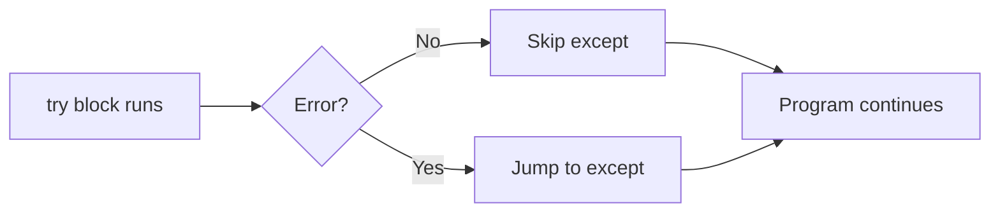

<style>
/* The default theme greys out the first paragraph under a title; keep it readable. */
:global(.slidev-page .slidev-layout h1 + p) {
  opacity: 1;
}
</style>

<div class="absolute inset-0 bg-[#E8522A]" />

<div class="absolute top-6 left-8 flex items-center gap-3 text-white">
  <div class="w-10 h-10 bg-white rounded flex items-center justify-center">
    <svg viewBox="0 0 40 40" class="w-8 h-8" fill="#E8522A" xmlns="http://www.w3.org/2000/svg" role="img" aria-label="ReDI School logo">
      <rect x="4" y="4" width="14" height="14" rx="1"/>
      <rect x="22" y="4" width="14" height="14" rx="1"/>
      <rect x="4" y="22" width="14" height="14" rx="1"/>
      <rect x="22" y="22" width="14" height="14" rx="1"/>
    </svg>
  </div>
  <span class="text-lg font-semibold tracking-wide">ReDISchool</span>
</div>
<div class="absolute top-8 right-8 text-white text-lg font-medium">Week 10</div>

<div class="absolute bottom-32 left-12 right-12 text-white">
  <p class="text-xl font-light opacity-90 mb-2">Introduction to Programming · Fall 2026</p>
  <h1 class="text-6xl font-light leading-tight mb-6">Error handling and modules</h1>
  <p class="text-2xl font-light opacity-90 mt-4">Programs break. Make yours handle it.</p>
  <p class="text-xl font-light opacity-90 mt-4">Catch errors, then reuse code that other people (and you) already wrote.</p>
</div>

---

# What we'll learn today

1. **Error handling:** read an error message, catch it, and keep the program running.
2. **Modules:** use Python's built in tools, and split your own code into files.
3. **Put it together:** a small game that uses both.

<div class="rounded p-5 mt-8" style="background: rgba(232, 82, 42, 0.12); border-left: 4px solid #E8522A;">
  <div class="text-sm font-semibold text-[#E8522A] uppercase tracking-widest">Plan for the 3 hours</div>
  <div class="mt-2">Short explanation, then you practice. Every part has exercises. The break is in the middle.</div>
</div>

---

<div class="text-sm font-semibold text-[#E8522A] uppercase tracking-widest mb-4">Week 10 · Error handling and modules</div>

## Part 1: Error handling

Stop your program from crashing when something goes wrong.

<div class="agenda [&_td]:py-1">

|  |  |
|---|---|
| 01 | Errors happen |
| 02 | Reading an error message |
| 03 | Common error types |
| 04 | `try` and `except` |
| 05 | Catching a specific error |
| 06 | Ask again until it is valid |
| 07 | Raising your own error |

</div>

Practice: three exercises.

---

# 01 · Errors happen

A user types a word where you expected a number.

```python
age = int(input("How old are you? "))
print(f"Next year you will be {age + 1}")
```

```text
How old are you? twelve
Traceback (most recent call last):
  File "age.py", line 1, in <module>
    age = int(input("How old are you? "))
ValueError: invalid literal for int() with base 10: 'twelve'
```

The program **crashes**. Nothing after the error runs.

Errors are normal. Good programs plan for them.

---

# 02 · Reading an error message

Read it from the **bottom** up.

```text
Traceback (most recent call last):
  File "shop.py", line 9, in <module>
    total = add_prices(prices)
  File "shop.py", line 4, in add_prices
    return sum(prices) / len(prices)
ZeroDivisionError: division by zero
```

<div class="grid grid-cols-3 gap-6 mt-6">
<div class="rounded p-5 bg-[#f3f3f3] text-[#222]" style="border-top: 4px solid #E8522A">
<div class="text-sm font-semibold text-[#E8522A] uppercase tracking-widest">Last line</div>
<div class="mt-2 text-sm">The error <b>type</b> and a message. Start here.</div>
</div>
<div class="rounded p-5 bg-[#f3f3f3] text-[#222]" style="border-top: 4px solid #2f6fdc">
<div class="text-sm font-semibold uppercase tracking-widest" style="color: #2f6fdc;">Line above it</div>
<div class="mt-2 text-sm">The file and line number where it happened.</div>
</div>
<div class="rounded p-5 bg-[#f3f3f3] text-[#222]" style="border-top: 4px solid #2e9e5b">
<div class="text-sm font-semibold uppercase tracking-widest" style="color: #1f8a4c;">Lines above that</div>
<div class="mt-2 text-sm">The path of function calls that led there.</div>
</div>
</div>

---

# 03 · Common error types

| Error | When it happens | Example |
|---|---|---|
| `ValueError` | Right type, wrong value | `int("abc")` |
| `TypeError` | Wrong type for the operation | `"Age: " + 30` |
| `ZeroDivisionError` | Dividing by zero | `10 / 0` |
| `IndexError` | List position does not exist | `[1, 2, 3][5]` |
| `KeyError` | Dictionary key does not exist | `{"a": 1}["b"]` |
| `FileNotFoundError` | The file is not there | `open("nope.txt")` |
| `NameError` | A variable name that does not exist | `print(nmae)` |

A **SyntaxError** is different. Python finds it before running anything, because the code is written wrong (a missing colon or bracket).

---
class: knowledge-check-slide
---

# Predict the error

Which error type does each line cause?

```python
a = int("3.5")
b = [10, 20, 30]
print(b[3])
c = {"name": "Ana"}
print(c["age"])
```

Take one minute. Talk to your neighbor.

<!-- solution:start -->
---
class: knowledge-check-slide knowledge-solution-slide
---

# Solution: Predict the error

- `int("3.5")` is a `ValueError`. `int()` cannot turn text with a dot into a whole number.
- `b[3]` is an `IndexError`. A list with 3 items has positions 0, 1 and 2.
- `c["age"]` is a `KeyError`. The dictionary has no `"age"` key.

Python stops at the **first** error, so you only see one of them per run.
<!-- solution:end -->

---
class: knowledge-check-slide exercise-slide
---

# Exercise: Read the errors · 10 min

Run each snippet. Read the last line of the error. Then fix the code so it works.

<div class="grid grid-cols-2 gap-6 [&_td]:py-1 [&_th]:py-1">
<div>

```python
# 1
print(int("abc"))

# 2
numbers = [1, 2, 3]
print(numbers[3])

# 3
ages = {"Ana": 30}
print(ages["Ben"])

# 4
print("I am " + 30 + " years old")
```

</div>
<div>

**Steps**

1. Put each snippet in `exercise.py` one at a time.
2. Write down the error type for each.
3. Fix it so it prints something sensible.
4. **(Advanced)** Make snippet 3 print `Ben is not in the list` when the name is missing, using `if` and `in`.

**Help**

```python
print("Age: " + str(30))
```

</div>
</div>

<!-- solution:start -->
---
class: knowledge-check-slide knowledge-solution-slide
---

# Solution: Read the errors

```python
# 1  ValueError. "abc" is not a number.
print(int("42"))

# 2  IndexError. The last position is 2.
numbers = [1, 2, 3]
print(numbers[2])

# 3  KeyError. Check first with `in`.
ages = {"Ana": 30}
if "Ben" in ages:
    print(ages["Ben"])
else:
    print("Ben is not in the list")

# 4  TypeError. Turn the number into text.
print("I am " + str(30) + " years old")
```
<!-- solution:end -->

---

# 04 · `try` and `except`

Try the risky code. If it fails, run the `except` block instead of crashing.

<div class="grid grid-cols-2 gap-8 items-start">
<div>

```python
try:
    age = int(input("How old are you? "))
    print(f"Next year: {age + 1}")
except ValueError:
    print("Please type a number.")

print("The program keeps going")
```

</div>
<div>

```text
How old are you? twelve
Please type a number.
The program keeps going
```

```text
How old are you? 12
Next year: 13
The program keeps going
```

</div>
</div>



---

# 05 · Catching a specific error

Name the error you expect. Other errors still show up, which is what you want.

```python
def safe_divide(a, b):
    try:
        return a / b
    except ZeroDivisionError:
        print("You cannot divide by zero.")
        return None

print(safe_divide(10, 2))   # 5.0
print(safe_divide(10, 0))   # message, then None
```

<div class="rounded p-5 mt-4" style="background: rgba(232, 82, 42, 0.12); border-left: 4px solid #E8522A;">
  <div class="text-sm font-semibold text-[#E8522A] uppercase tracking-widest">Avoid</div>
  <div class="mt-2">A bare <code>except:</code> with no name catches everything, even your own typos. You will never find the bug.</div>
</div>

---

# Several errors, and a file example

<div class="grid grid-cols-2 gap-8 items-start">
<div>

Handle different errors in different ways.

```python
try:
    number = int(input("Number: "))
    print(10 / number)
except ValueError:
    print("That is not a number.")
except ZeroDivisionError:
    print("Zero does not work.")
```

</div>
<div>

Reading a file that might not exist (from last week):

```python
try:
    with open("shopping.txt") as file:
        for line in file:
            print(line.strip())
except FileNotFoundError:
    print("No list yet. Start one!")
```

</div>
</div>

Python checks the `except` blocks from top to bottom and runs the first one that matches.

---

# `else` and `finally`

Two optional parts. You will see them in other people's code.

```python
try:
    number = int(input("Number: "))
except ValueError:
    print("Not a number.")
else:
    print(f"Double is {number * 2}")   # runs only if no error
finally:
    print("Done.")                      # runs every time
```

- `else` runs when the `try` block worked.
- `finally` runs no matter what. Useful for cleanup.
- You do not need either one to start. `try` and `except` are enough.

---
class: knowledge-check-slide
---

# Predict the output

```python
def convert(text):
    try:
        return int(text)
    except ValueError:
        return 0

print(convert("8"))
print(convert("eight"))
print(convert("8") + convert("2"))
```

What three lines are printed?

<!-- solution:start -->
---
class: knowledge-check-slide knowledge-solution-slide
---

# Solution: Predict the output

```text
8
0
10
```

- `"8"` converts fine.
- `"eight"` fails, so the `except` block returns `0`.
- `8 + 2` is `10`.
<!-- solution:end -->

---

# 06 · Ask again until it is valid

Combine a `while` loop with `try` and `except`.

```python
while True:
    text = input("Enter a number: ")
    try:
        number = int(text)
        break                       # valid, leave the loop
    except ValueError:
        print("That is not a number. Try again.")

print(f"You entered {number}")
```

```text
Enter a number: abc
That is not a number. Try again.
Enter a number: 7
You entered 7
```

`break` only runs when `int()` worked. Otherwise the loop goes around again.

---
class: knowledge-check-slide exercise-slide
---

# Exercise: Safe number input · 10 min

Write a function `ask_for_number(prompt)` that keeps asking until the user types a whole number. It then **returns** that number.

<div class="grid grid-cols-2 gap-6 [&_td]:py-1 [&_th]:py-1">
<div>

**Expected input and output**

```text
Enter your age: abc
That is not a number. Try again.
Enter your age: 29
```

```python
age = ask_for_number("Enter your age: ")
print(age + 1)    # 30
```

**(Advanced)** Only accept numbers from 1 to 120. Print `Please type a number from 1 to 120.` otherwise.

</div>
<div>

**Help**

```python
def ask_for_name():
    while True:
        text = input("Name: ")
        if text != "":
            return text
        print("Name cannot be empty.")
```

`return` leaves the function, so it also leaves the loop.

</div>
</div>

<!-- solution:start -->
---
class: knowledge-check-slide knowledge-solution-slide
---

# Solution: Safe number input

```python
def ask_for_number(prompt):
    while True:
        text = input(prompt)
        try:
            return int(text)
        except ValueError:
            print("That is not a number. Try again.")

# Advanced
def ask_for_age(prompt):
    while True:
        age = ask_for_number(prompt)
        if 1 <= age <= 120:
            return age
        print("Please type a number from 1 to 120.")
```
<!-- solution:end -->

---

# 07 · Raising your own error

Sometimes **you** know something is wrong. Use `raise` to stop and report it.

```python
def set_age(age):
    if age < 0:
        raise ValueError("Age cannot be negative")
    return age

print(set_age(30))     # 30
print(set_age(-5))     # crashes
```

```text
ValueError: Age cannot be negative
```

The caller can then catch it with `try` and `except`, like any other error.

```python
try:
    set_age(-5)
except ValueError as error:
    print(f"Problem: {error}")     # Problem: Age cannot be negative
```

`as error` gives you the message so you can print it.

---
class: knowledge-check-slide exercise-slide
---

# Exercise: Safe wallet · 15 min

Add a `withdraw` method to the `Wallet` class from last week.

1. `withdraw(amount)` takes money out of the wallet.
2. If `amount` is 0 or less, `raise ValueError("Amount must be more than 0")`.
3. If `amount` is more than the money in the wallet, `raise ValueError("Not enough money")`.
4. Test it: loop over the amounts `50`, `500` and `-5`. Use `try` and `except` to print the message.

<div class="grid grid-cols-2 gap-6 [&_td]:py-1 [&_th]:py-1">
<div>

**Expected output**

```text
Ana has 150 DKK
Not enough money
Amount must be more than 0
```

</div>
<div>

**Help**

```python
class Wallet:
    def __init__(self, owner, money):
        self.owner = owner
        self.money = money

    def withdraw(self, amount):
        ...   # your checks, then change self.money
```

</div>
</div>

<!-- solution:start -->
---
class: knowledge-check-slide knowledge-solution-slide
---

# Solution: Safe wallet

```python
class Wallet:
    def __init__(self, owner, money):
        self.owner = owner
        self.money = money

    def withdraw(self, amount):
        if amount <= 0:
            raise ValueError("Amount must be more than 0")
        if amount > self.money:
            raise ValueError("Not enough money")
        self.money = self.money - amount

ana = Wallet("Ana", 200)

for amount in [50, 500, -5]:
    try:
        ana.withdraw(amount)
        print(f"{ana.owner} has {ana.money} DKK")
    except ValueError as error:
        print(error)
```
<!-- solution:end -->

---
layout: center
---

# Break

15 minutes

---

<div class="text-sm font-semibold text-[#E8522A] uppercase tracking-widest mb-4">Week 10 · Error handling and modules</div>

## Part 2: Modules

Use code that already exists. Organize your own.

<div class="agenda [&_td]:py-1">

|  |  |
|---|---|
| 08 | What is a module? |
| 09 | `import` |
| 10 | Useful built in modules |
| 11 | Your own module |
| 12 | Installing other modules |

</div>

Practice: dice, then your own module.

---

# 08 · What is a module?

A **module** is a Python file full of ready made tools (functions and values) that you can use in your program.

<div class="rounded p-5 mt-6" style="background: rgba(232, 82, 42, 0.12); border-left: 4px solid #E8522A;">
  <div class="text-sm font-semibold text-[#E8522A] uppercase tracking-widest">Module</div>
  <div class="mt-2">A <code>.py</code> file with code you can <code>import</code> into another file.</div>
</div>

Why use modules?

- **Do not rebuild the wheel.** Python already knows how to pick random numbers and work with dates.
- **Keep files small.** Put related code in its own file with a clear name.
- **Reuse.** Write a function once, use it in many programs.

Python comes with hundreds of modules. This is called the **standard library**.

---

# 09 · `import`

<div class="grid grid-cols-2 gap-8 items-start">
<div>

Bring in the whole module. Use a dot to reach what is inside.

```python
import math

print(math.sqrt(144))    # 12.0
print(math.pi)           # 3.14159...
print(math.ceil(4.2))    # 5
```

</div>
<div>

Bring in only what you need. No dot needed.

```python
from math import sqrt, pi

print(sqrt(144))         # 12.0
print(pi)                # 3.14159...
```

</div>
</div>

Give a module a shorter name with `as`:

```python
import random as rnd
print(rnd.randint(1, 6))
```

Put imports at the **top** of the file. For beginners, `import math` is the clearest, because `math.sqrt` shows where `sqrt` comes from.

---

# 10 · Useful built in modules

| Module | What it does | Try |
|---|---|---|
| `random` | Random numbers and choices | `random.randint(1, 6)` |
| `random` | Pick from a list | `random.choice(["red", "blue"])` |
| `math` | Maths tools | `math.sqrt(81)` |
| `datetime` | Dates and times | `date.today()` |
| `os` | Work with files and folders | `os.path.exists("a.txt")` |

```python
import random
from datetime import date

print(random.randint(1, 6))                  # a number from 1 to 6
print(random.choice(["pizza", "pasta"]))     # one of the two
print(date.today())                          # 2026-11-30
print(date.today().year)                     # 2026
```

You can see everything a module offers with `help(math)` or by searching "python math module".

---
class: knowledge-check-slide exercise-slide
---

# Exercise: Dice and dates · 10 min

Use the `random`, `math` and `datetime` modules.

1. Roll a dice 5 times and print each result (1 to 6).
2. Pick a random lunch from the list `["pizza", "salad", "soup", "pasta"]` and print it.
3. Print the square root of 144 and `pi` rounded to 2 decimals.
4. **(Advanced)** Print how many days are left until January 1 of next year.

<div class="grid grid-cols-2 gap-6 [&_td]:py-1 [&_th]:py-1">
<div>

**Example output** (yours will differ)

```text
Roll: 4
Roll: 1
Roll: 6
Roll: 3
Roll: 3
Lunch: soup
12.0
3.14
```

</div>
<div>

**Help**

```python
import random
from datetime import date

today = date.today()
new_year = date(today.year + 1, 1, 1)
difference = new_year - today
print(difference.days)
```

`round(3.14159, 2)` gives `3.14`.

</div>
</div>

<!-- solution:start -->
---
class: knowledge-check-slide knowledge-solution-slide
---

# Solution: Dice and dates

```python
import math
import random
from datetime import date

for i in range(5):
    print("Roll:", random.randint(1, 6))

lunches = ["pizza", "salad", "soup", "pasta"]
print("Lunch:", random.choice(lunches))

print(math.sqrt(144))
print(round(math.pi, 2))

# Advanced
today = date.today()
new_year = date(today.year + 1, 1, 1)
print((new_year - today).days, "days left")
```
<!-- solution:end -->

---

# 11 · Your own module

Any `.py` file is a module. Put code you want to reuse in its own file, then import it.

<div class="grid grid-cols-2 gap-8 items-start">
<div>

`helpers.py`

```python
def average(numbers):
    return sum(numbers) / len(numbers)

def shout(text):
    return text.upper() + "!"
```

</div>
<div>

`main.py` (in the **same folder**)

```python
import helpers

print(helpers.average([4, 8, 6]))   # 6.0
print(helpers.shout("hello"))       # HELLO!
```

</div>
</div>

- Import by the file name, **without** `.py`.
- Run `main.py`. The file you run is the one that imports the others.
- Pick names that do not match a built in module. A file called `random.py` will break `import random`.

---

# `if __name__ == "__main__"`

When you import a file, Python **runs it from top to bottom**. Test code in the module would run too.

<div class="grid grid-cols-2 gap-8 items-start">
<div>

```python
# helpers.py
def shout(text):
    return text.upper() + "!"

print(shout("test"))     # runs on import!
```

</div>
<div>

```python
# helpers.py
def shout(text):
    return text.upper() + "!"

if __name__ == "__main__":
    print(shout("test"))
```

</div>
</div>

The `if` line means: "only run this when I run **this file** directly, not when someone imports it."

You will see this line in most Python programs. Copy the pattern for now. The details can wait.

---
class: knowledge-check-slide exercise-slide
---

# Exercise: Make your own module · 15 min

1. Make a new folder with two files: `helpers.py` and `main.py`.
2. In `helpers.py`, put in your `ask_for_number` function from earlier, and write `average(numbers)`, which returns the average of a list.
3. In `main.py`, import `helpers`. Ask for 3 numbers, store them in a list, and print the average.
4. **(Advanced)** Add `highest(numbers)` to `helpers.py`. Print the highest number too. Do not use `max()`.

<div class="grid grid-cols-2 gap-6 [&_td]:py-1 [&_th]:py-1">
<div>

**Expected output**

```text
Number 1: 4
Number 2: abc
That is not a number. Try again.
Number 2: 8
Number 3: 6
Average: 6.0
Highest: 8
```

</div>
<div>

**Help**

```python
import helpers

numbers = []
for i in range(3):
    value = helpers.ask_for_number(f"Number {i + 1}: ")
    numbers.append(value)
```

Both files must be in the same folder. Open that folder in VS Code.

</div>
</div>

<!-- solution:start -->
---
class: knowledge-check-slide knowledge-solution-slide
---

# Solution: Make your own module

```python
# helpers.py
def ask_for_number(prompt):
    while True:
        text = input(prompt)
        try:
            return int(text)
        except ValueError:
            print("That is not a number. Try again.")

def average(numbers):
    return sum(numbers) / len(numbers)

def highest(numbers):
    best = numbers[0]
    for number in numbers:
        if number > best:
            best = number
    return best
```

<!-- solution:end -->

<!-- solution:start -->
---
class: knowledge-check-slide knowledge-solution-slide
---

# Solution: Make your own module (main.py)

```python
# main.py
import helpers

numbers = []
for i in range(3):
    numbers.append(helpers.ask_for_number(f"Number {i + 1}: "))

print("Average:", helpers.average(numbers))
print("Highest:", helpers.highest(numbers))
```
<!-- solution:end -->

---

# 12 · Installing other modules

The standard library is big, but other people share modules too. Install them with **pip**, in the terminal.

```bash
pip install cowsay          # macOS may need: pip3 install cowsay
```

```python
import cowsay

cowsay.cow("Hello class!")
```

- Thousands of modules exist for data, websites, games, and more. You find them on **pypi.org**.
- Install once, then `import` as usual.
- Only install modules from sources you trust. A module is code that runs on your computer.

<div class="mt-4 opacity-80">Optional. You will need this for projects that use other people's tools.</div>

---

<div class="text-sm font-semibold text-[#E8522A] uppercase tracking-widest mb-4">Week 10 · Error handling and modules</div>

## Part 3: Put it together

A number guessing game, using everything from today.

<div class="grid grid-cols-3 gap-6 mt-8">
<div class="rounded p-5 bg-[#f3f3f3] text-[#222]" style="border-top: 4px solid #E8522A">
<div class="text-sm font-semibold text-[#E8522A] uppercase tracking-widest">Modules</div>
<div class="mt-3 opacity-80"><code>random</code> picks the secret number. <code>helpers</code> asks for guesses.</div>
</div>
<div class="rounded p-5 bg-[#f3f3f3] text-[#222]" style="border-top: 4px solid #2f6fdc">
<div class="text-sm font-semibold uppercase tracking-widest" style="color: #2f6fdc;">Error handling</div>
<div class="mt-3 opacity-80">Typing a word instead of a number must not crash the game.</div>
</div>
<div class="rounded p-5 bg-[#f3f3f3] text-[#222]" style="border-top: 4px solid #2e9e5b">
<div class="text-sm font-semibold uppercase tracking-widest" style="color: #1f8a4c;">Loops</div>
<div class="mt-3 opacity-80">Keep guessing until the number is found.</div>
</div>
</div>

---
class: knowledge-check-slide exercise-slide
---

# Exercise: Guessing game · 20 min

The computer picks a secret number from 1 to 20. The player guesses until they win.

1. Use `random.randint(1, 20)` to pick the secret number.
2. Use `ask_for_number` from your `helpers.py` to read each guess.
3. After each guess, print `Too low`, `Too high`, or `Correct!`.
4. Count the guesses and print the total at the end.
5. **(Advanced)** Stop after 5 guesses and reveal the number. Or save the best score in a file.

<div class="grid grid-cols-2 gap-6 [&_td]:py-1 [&_th]:py-1">
<div>

**Example run**

```text
Guess: 10
Too low
Guess: hello
That is not a number. Try again.
Guess: 15
Too high
Guess: 12
Correct! You needed 3 guesses.
```

</div>
<div>

**Help**

```python
import random
import helpers

secret = random.randint(1, 20)
guesses = 0

while True:
    guess = helpers.ask_for_number("Guess: ")
    guesses = guesses + 1
    # compare guess with secret here
```

Use `break` to leave the loop when the guess is right.

</div>
</div>

<!-- solution:start -->
---
class: knowledge-check-slide knowledge-solution-slide
---

# Solution: Guessing game

```python
import random
import helpers

secret = random.randint(1, 20)
guesses = 0

while True:
    guess = helpers.ask_for_number("Guess: ")
    guesses = guesses + 1

    if guess < secret:
        print("Too low")
    elif guess > secret:
        print("Too high")
    else:
        print(f"Correct! You needed {guesses} guesses.")
        break
```

Advanced: change `while True:` to `while guesses < 5:` and print the secret after the loop if the player did not win.
<!-- solution:end -->

---

# Common mistakes

| Mistake | What you see | Fix |
|---|---|---|
| Bare `except:` | Bugs disappear and nothing tells you why | Name the error: `except ValueError:` |
| Wrong error name | The error still crashes the program | Read the last line of the traceback and copy the type |
| Module file in another folder | `ModuleNotFoundError: No module named 'helpers'` | Put both files in the same folder and open that folder in VS Code |
| File named `random.py` | `AttributeError: module 'random' has no attribute 'randint'` | Rename your file |
| `import helpers.py` | `ModuleNotFoundError` | Leave out `.py` |
| Forgetting `str()` | `TypeError: can only concatenate str` | `"Age: " + str(age)` |

---

# The main ideas

- An error stops the program. Read the **last line** of the message first. It names the error type.
- `try` runs risky code. `except ErrorName:` runs if that error happens.
- Name the error you expect. Avoid a bare `except:`.
- Use `while True` with `try` and `break` to ask again until the input is valid.
- `raise ValueError("message")` reports a problem you found yourself.
- A **module** is a `.py` file you can `import`. Python comes with many (`random`, `math`, `datetime`).
- `import math` then `math.sqrt(9)`, or `from math import sqrt` then `sqrt(9)`.
- Your own files work as modules too. Keep them in the same folder.
- `pip install` adds modules that other people made.

---

<div class="text-sm font-semibold text-[#E8522A] uppercase tracking-widest mb-4">Week 10 · Your project</div>

## Before next week

Think about your project again. You now have more tools.

<div class="grid grid-cols-3 gap-6 mt-10">
<div class="rounded p-5 bg-[#f3f3f3] text-[#222]" style="border-top: 4px solid #E8522A">
<div class="text-sm font-semibold text-[#E8522A] uppercase tracking-widest">Today</div>
<div class="mt-2 text-2xl">Error handling and modules</div>
<div class="mt-3 opacity-80">Where could your program fail? Which module could help?</div>
</div>
<div class="rounded p-5 bg-[#f3f3f3] text-[#222]" style="border-top: 4px solid #E8522A">
<div class="text-sm font-semibold text-[#E8522A] uppercase tracking-widest">Week 11</div>
<div class="mt-2 text-2xl">Start building</div>
<div class="mt-3 opacity-80">Write your project in class. We will be there to help.</div>
</div>
<div class="rounded p-5 bg-[#f3f3f3] text-[#222]" style="border-top: 4px solid #E8522A">
<div class="text-sm font-semibold text-[#E8522A] uppercase tracking-widest">Week 12</div>
<div class="mt-2 text-2xl">Present</div>
<div class="mt-3 opacity-80">Show your work to the class. 5 minutes each.</div>
</div>
</div>

<div class="mt-10">Come with one clear idea written down in a sentence.</div>

---
layout: center
---

# Questions?
